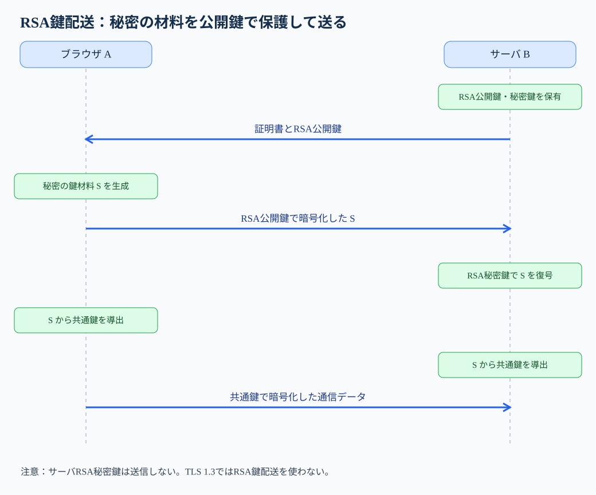
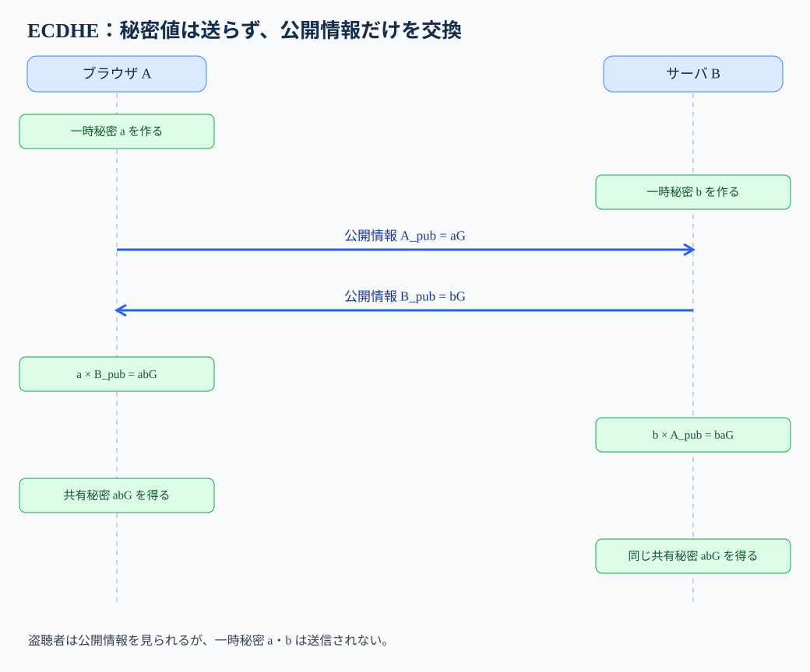
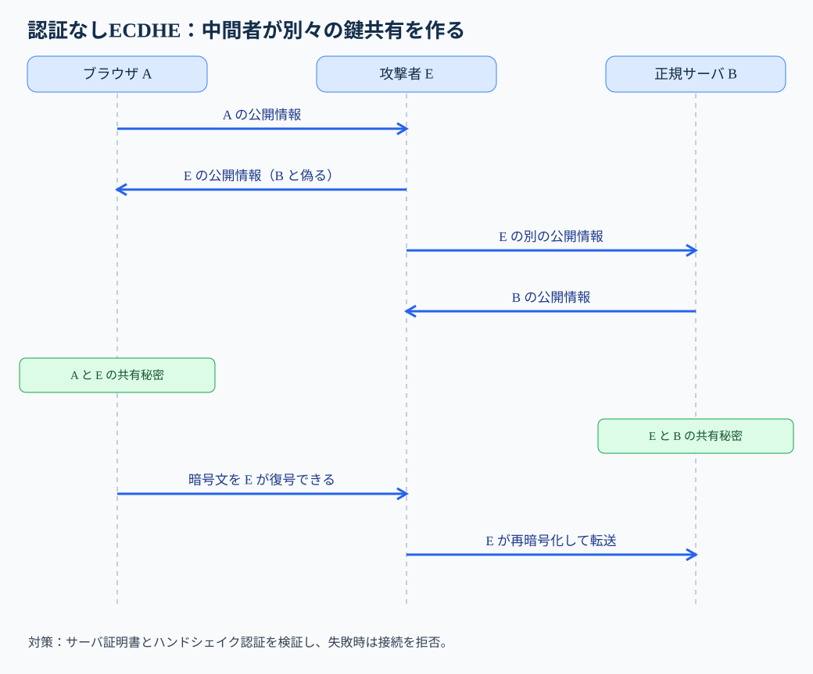
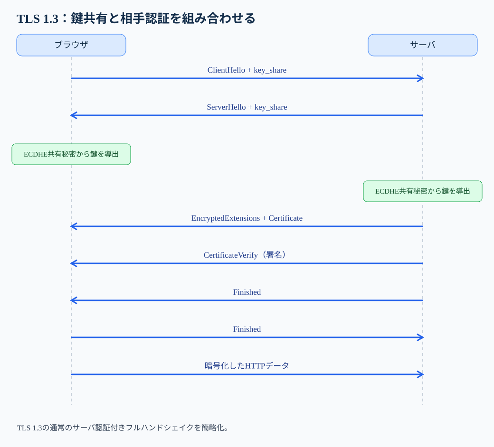

# 第36講　ハイブリッド暗号

**到達目標**：①大量データをAESで暗号化しつつ、鍵の共有に公開鍵技術を使う理由を説明する。②RSA鍵配送とECDHE鍵共有を、誰が何を作り何を送るかで区別する。③TLSの相手認証とForward Secrecyを理解し、科目Bで攻撃原因・影響・対策を説明する。

**参考書**：『徹底攻略 情報処理安全確保支援士教科書 令和7年度版』第4章4-1「暗号化」（印刷256〜266頁。特に共通鍵・公開鍵・RSA・楕円曲線暗号）、第6章6-1「セキュリティプロトコル」のTLS（印刷378〜381頁）。**出典の区別**：これらの基本事項を踏まえ、ECDHEの計算例、TLS 1.3の具体的なメッセージ順、攻撃事例、答案作成過程は講師による補足。参考書の文章を転載したものではない。

**学習優先度**：A（必須）約75％＝鍵の役割、RSA鍵配送とECDHE、証明書検証、Forward Secrecy、TLSの読み方。B（理解補助）約20％＝楕円曲線の計算イメージ、鍵導出、ハンドシェイク。C（発展）約5％＝暗号ライブラリの実装詳細、鍵導出の内部式など。Cは試験対策として任意。

## 1. そもそも「暗号化する鍵」をどうやって相手に渡すのか

ネットショップでカード情報を送る場面を考えましょう。ブラウザが送るカード番号を第三者に読ませないためには、暗号化が必要です。ここで既習のAESを思い出してください。AESは共通鍵暗号で、暗号化にも復号にも、通信する双方が同じ秘密の鍵を使用します。大量のデータを効率よく処理できるのが長所です。

ところが、初めて接続したショップのサーバとブラウザは、まだ共通の秘密鍵を持っていません。ブラウザが「今回のAES鍵はこれです」と平文で送ったら、通信経路を盗聴する攻撃者にもその鍵が見えます。以後の通信をAESで暗号化しても、攻撃者が同じ鍵で復号できてしまいます。**通信を守るための鍵を、守られていない通信路でどう共有するか**。ここが出発点です。

では公開鍵暗号だけでカード情報や動画まで全部暗号化すればよいでしょうか。公開鍵暗号は、相手の公開鍵で秘密情報を保護したり、署名による認証に使ったりできますが、大量データを処理する用途では共通鍵暗号より計算負荷が大きく、通常の通信本文の暗号化には適しません。

そこで役割を分けます。**公開鍵技術を使って通信鍵を安全に確立し、実際の大量データはAESなどの共通鍵暗号で保護する**。これがハイブリッド暗号の基本発想です。注意したいのは「公開鍵で必ずAES鍵そのものを暗号化する」という意味ではないことです。後で学ぶECDHEは、秘密の鍵を送るのではなく、双方で同じ秘密を計算する方式です。

| 役割 | 主な技術 | この講義での仕事 |
|---|---|---|
| 通信本文の暗号化 | AES-GCMなどの共通鍵暗号 | HTTPの内容を高速に保護する |
| 鍵の確立 | 歴史的なRSA鍵配送、現行TLSのECDHEなど | 通信に使う秘密を双方で得る |
| 相手の認証 | 証明書、デジタル署名、ハンドシェイクの検証 | 鍵を共有した相手が正規サーバか確かめる |

## 2. RSA鍵配送型――作った秘密を相手に届ける

まず、歴史的に使われたRSA鍵配送型を考えます。登場人物は、送信者A（ブラウザ）、受信者B（サーバ）、盗聴者Eです。BはRSAの**公開鍵**と**秘密鍵**を持っています。公開鍵はAに渡してよい情報、秘密鍵はBだけが保持する情報です。

1. **Bの公開鍵を確認する**：AはBのサーバ証明書などを通じて公開鍵を得ます。ただし、受け取った公開鍵が本当にBのものか検証する必要があります。
2. **Aが秘密情報を作る**：Aはセッション鍵の材料となる秘密情報を生成します。古典的なTLSのRSA鍵配送では、正確には *pre-master secret* を生成してRSAで暗号化し、双方がそこから鍵を導きます。説明用に、これを鍵材料 `S` と呼びます。
3. **Bの公開鍵でSを暗号化して送る**：Eは暗号文を見られても、BのRSA秘密鍵なしにはSを容易に取り出せません。
4. **Bが自分のRSA秘密鍵で復号する**：BもSを得ます。双方はSなどから通信鍵を導出します。
5. **通信本文をAESなどで暗号化する**：以後の大量データの保護には、RSAではなく共通鍵暗号を使います。



図の青い経路で渡すのは**RSAで暗号化した鍵材料**です。カード情報そのものをRSAで暗号化して送り続けるわけではありません。サーバ秘密鍵はネットワークに流れません。ここで「公開鍵なら誰でも入手できるのに、なぜ秘密を守れるのか」という疑問が出ます。RSAは公開鍵で暗号化できても、対応する秘密鍵がなければ復号が計算上困難になるよう設計されています。ただし鍵長、パディング、実装などが安全であることが前提です。

**この方式の弱点を考える**：Eが今日の通信を全部記録しておき、数年後にBの長期RSA秘密鍵を盗んだらどうでしょう。記録済みのRSA暗号文から当時の鍵材料Sを復号し、通信鍵を再現できるおそれがあります。**現在は安全でも、後日の長期秘密鍵漏えいが過去の通信に影響する**のです。この問題が次のECDHEとForward Secrecyを理解する入口になります。

なお、TLS 1.3ではRSA鍵配送は使用しません。「TLSでRSAを使う」という表現が出たら、**鍵配送にRSAを使うのか、認証の署名にRSAを使うのか**を区別してください。

## 3. ECDHE――鍵を送らずに、双方で同じ秘密を作る

ここからが第36講の中心です。前節ではAが秘密情報Sを作り、暗号化してBへ送りました。ECDHEは発想を変えます。**最終的に同じ秘密を計算するが、その秘密そのものは通信路に流さない**のです。

### 3-1. まず、なぜそれが必要なのか

AESのような共通鍵暗号には、AとBが同じ秘密鍵を持つ必要があります。しかし最初から秘密の通信路はありません。RSA鍵配送なら秘密情報を公開鍵で保護して送れますが、サーバの長期秘密鍵が後日漏えいしたとき、保存されていた過去通信が解読される可能性があります。そこで、**サーバの長期秘密鍵から過去の通信鍵を直接復元できない鍵共有**が望まれます。

### 3-2. 送る情報と、絶対に送らない情報

Aは自分だけが知る一時的な秘密値 `a` を作り、Bは自分だけが知る `b` を作ります。この `a` と `b` は送信しません。代わりに、それぞれが秘密値から計算した**公開してよい情報**を交換します。

「公開情報を見れば秘密値を逆算できるのでは？」という疑問は自然です。ECDHEでは楕円曲線上の離散対数問題の計算困難性を利用します。適切な方式とパラメータなら、公開情報から元の秘密値を実用的な時間で求めるのは困難です。これは「数学的に絶対不可能」という意味ではなく、現在の計算能力に対して困難という意味です。

### 3-3. 五つのステップで追う

**① 秘密値を生成**：Aは `a`、Bは `b` を新しく作ります。盗聴者Eにも相手にも秘密です。`E` は公開鍵ではなく、ここでは攻撃者の名前です。

**② 公開情報を計算**：公開の基準点を `G` とすると、Aは `A_pub = aG`、Bは `B_pub = bG` を計算します。`aG` は普通の数値の掛け算ではなく、楕円曲線上の点のスカラー倍です。細かな演算手順を暗記する必要はありません。

**③ 公開情報を交換**：Aは `A_pub` をBへ、Bは `B_pub` をAへ送ります。盗聴者Eにもこの二つは見えますが、`a` と `b` は送られません。

**④ 同じ共有秘密を計算**：Aは受け取った `B_pub` に自分の `a` を作用させて `a(bG)=abG` を得ます。Bは受け取った `A_pub` に自分の `b` を作用させて `b(aG)=baG` を得ます。楕円曲線の演算の性質で `abG=baG` となるため、**同じ秘密が両側で得られます**。Eには公開情報しかなく、同じ計算を容易にはできません。

**⑤ 通信鍵を導く**：この共有秘密をそのままAES鍵にするわけではありません。TLSでは共有秘密やハンドシェイクの情報を材料としてHKDFなどの鍵導出処理を行い、送受信に使う鍵やIVなどを導きます。本文を暗号化するのはAES-GCMなどです。



図の**秘密値a・bは各端末の内側にとどまる**点が最重要です。ネットワークを流れるのは公開情報です。AからB、BからAへ向かう矢印は「秘密鍵を渡す」矢印ではありません。最後の共有秘密は両側に同じ値として現れますが、ネットワーク上を移動していません。

### 3-4. なぜ「E」なのか

ECDHEの最後のEは *Ephemeral*（一時的な）です。接続ごとに新しい一時秘密値を作り、必要がなくなれば適切に破棄します。長期秘密鍵を何年も使い回すこととは役割が異なります。この一時性が、過去通信の保護につながります。

## 4. ECDHEだけでは「相手が本物か」は分からない

ここまでで、AとBは秘密を送らずに同じ値を計算できました。では「Aが鍵共有した相手は本当にショップBだった」と証明できたでしょうか。**いいえ。鍵共有と相手認証は別問題です。**

攻撃者EがAとBの通信の間に入り、Aには「私がBです」と偽り、Bには「私がAです」と偽ったとします。AはEの公開情報をBのものと思い込んで鍵共有し、BもEとの間で別の鍵共有をします。結果は、AとEの秘密鍵、EとBの秘密鍵という**二つの独立した通信路**です。EはAの暗号文を復号し、読んだり改ざんしたりしてからB向けに再暗号化できます。



この攻撃でECDHEの計算が破られたわけではありません。**本物の相手と鍵共有したか確認しなかった**のが原因です。TLSでは、サーバ証明書の検証と、ハンドシェイク内容に対する署名・認証を通じて鍵共有を正しいサーバに結び付けます。証明書検証を無効にしたり、証明書エラーを無視したりすると、この結び付けが失われます。

ここで「証明書があれば何でも安全」でもありません。証明書の信頼できる発行元、有効期間、接続先ホスト名などを検証し、署名とハンドシェイクの整合性を確認する必要があります。**正しい相手と鍵共有するための検証**なのです。

## 5. Forward Secrecy――後から長期秘密鍵が漏れても過去を守る

Forward Secrecy（前方秘匿性）は、「今日のサーバ長期秘密鍵が後日盗まれても、それだけで昨日の通信を解読されない」性質です。ここで**何の鍵が漏れたのか**が重要です。

RSA鍵配送型では、Aが送った鍵材料Sの暗号文をEが保存しておき、後からBのRSA秘密鍵を盗めば、過去のSを復号できる可能性があります。一方、ECDHEでは各通信で一時秘密値a・bを作り、長期秘密鍵は主に認証に使います。後日長期秘密鍵が漏れても、すでに破棄されたa・bが復元されるわけではありません。したがって、過去の通信鍵を求めるのは困難です。

| 漏えいしたもの | 過去の通信への典型的な影響 |
|---|---|
| RSA鍵配送で使ったサーバ長期RSA秘密鍵 | 記録済みの鍵配送暗号文から過去の通信鍵を再現されるおそれ |
| ECDHEの認証に使ったサーバ長期秘密鍵 | それだけでは過去の一時共有秘密を再現しにくい |
| 過去の実際のセッション鍵 | その鍵で保護された通信が解読されるおそれ。Forward Secrecyでも防げない |

ただし、Forward Secrecyは万能ではありません。攻撃者が通信当時に端末を侵害してセッション鍵を盗んでいた場合、長期秘密鍵だけの漏えいとは条件が違います。また、**現在の接続での相手認証**を保証する性質でもありません。試験では「過去か現在か」「長期鍵か一時鍵か」「鍵共有か認証か」を区別してください。

## 6. TLS 1.3で、これらがどうつながるか

ここまでの技術が、実際のHTTPSでどのように組み合わさるかを追います。TLS 1.3の一般的なサーバ認証付きハンドシェイクを簡略化したものです。再接続時のPSKや0-RTTなどはここでは扱いません。



**① ClientHello**：ブラウザが対応するTLSの方式や鍵共有用の公開情報（key_share）などを送ります。「どの方式で安全な通信を始められるか」という提案です。ここでまだHTTP本文を安全に送れるわけではありません。

**② ServerHello**：サーバが方式を選び、鍵共有用の公開情報を返します。双方はECDHEの共有秘密を計算し、ハンドシェイクを保護する鍵を導きます。**この時点で鍵共有が進んでも、まだ相手の正当性の検証は終わっていません。**

**③ EncryptedExtensionsとCertificate**：サーバは追加の接続条件を送り、証明書を示します。証明書は「この公開鍵が、接続先サーバに属する」という主張を検証する材料です。TLS 1.3ではServerHello以降の多くのハンドシェイクメッセージは暗号化されます。

**④ CertificateVerify**：サーバはハンドシェイクの文脈に対して秘密鍵で署名し、証明書に対応する鍵を保持していることを示します。ここでRSA署名が使われることはありますが、**RSAで通信鍵を配送しているわけではありません**。ECDSAなどの場合もあります。

**⑤ Finished**：これまでのハンドシェイク内容に改ざんがなく、必要な鍵を共有していることを確認するためのメッセージです。ブラウザ側もサーバ証明書や署名を正しく検証し、Finishedを交換します。証明書が不正なら接続を中止する必要があります。

**⑥ Application Data**：認証と鍵の確立が済んでから、HTTPリクエストやレスポンスをAES-GCMなどのAEAD方式で保護します。AEADは暗号化だけでなく、データが改ざんされていないことの検証も行う方式です。

「TLS 1.3ではRSAが禁止」という言い方には注意してください。**RSA鍵配送は採用されませんが、RSA署名は使えます**。またTLS 1.3の通常の鍵共有にはECDHEのほか、有限体DHの一時鍵共有であるDHEもあります。「TLS 1.3はECDHEだけ」と暗記しないでください。

## 7. 設定・ログを見て判断する

科目Bでは、方式名だけでなく「どの設定がどの危険につながるか」を読める必要があります。次は説明用の擬似ログであり、特定製品の実ログ形式ではありません。

```text
接続A: TLSv1.3 / key_exchange=X25519 / cipher=TLS_AES_256_GCM_SHA384
       certificate_validation=OK / handshake_authentication=OK
接続B: TLSv1.2 / cipher=TLS_RSA_WITH_AES_128_CBC_SHA
       certificate_validation=OK
接続C: TLSv1.3 / key_exchange=X25519 / cipher=TLS_AES_128_GCM_SHA256
       certificate_validation=DISABLED
```

**接続A**：X25519はECDHEに使われる楕円曲線の鍵共有方式です。AES-GCMで本文を保護し、証明書検証も成功しています。ただしログに「OK」とあるだけで、実際の実装や端末が絶対安全と断言することはできません。

**接続B**：`TLS_RSA_...` はTLS 1.2でのRSA鍵配送を示す古典的な暗号スイート名です。`RSA` が入っているから「RSA署名を使った」という意味ではありません。長期秘密鍵が後日漏えいしたときの過去通信への影響を検討する必要があります。

**接続C**：ECDHEで鍵共有していても、証明書検証が無効です。中間者による偽サーバへの接続を見抜けず、盗聴・改ざんを受けるおそれがあります。「鍵交換方式が安全だから問題なし」と判断してはいけません。

なおTLS 1.3の暗号スイート名 `TLS_AES_256_GCM_SHA384` は、TLS 1.2の名前と違い鍵共有方式や証明書署名方式を表しません。**鍵共有方式、データ暗号方式、認証方式は別々に確認する**のがポイントです。

## 8. 科目A・科目Bの答案に結び付ける

**科目Aの典型的な区別**：AESはデータ暗号化、ECDHEは共有秘密の確立、証明書と署名は相手認証、Forward Secrecyは長期秘密鍵の後日漏えいによる過去通信への影響の低減です。この四つを入れ替えた選択肢を見抜きます。

**科目B例題①**：「ECDHEを使うWebアプリで、サーバ証明書の検証を無効にしていた。危険と対策を説明せよ」

まず事実は「ECDHEを使用」「証明書検証は無効」です。ECDHEは共有秘密を作れますが、相手の身元を保証しません。攻撃者が間に入ると、利用者と攻撃者、攻撃者とサーバの二組で別々の鍵共有ができます。結果として通信内容の盗聴・改ざんが可能になります。したがって対策は、証明書の信頼性・接続先名・有効期間などを検証し、失敗時に接続を拒否することです。

**答案例**：「サーバの正当性を確認できないため、攻撃者が中間者として双方と別々に鍵共有し、通信を盗聴・改ざんするおそれがある。サーバ証明書の検証を有効にし、検証失敗時は接続を拒否する。」

**科目B例題②**：「通信を保存していた攻撃者が、数年後にサーバの長期秘密鍵を入手した。RSA鍵配送とECDHEではどう異なるか」

判断の順序は、①保存されたもの＝過去の暗号文、②漏えいしたもの＝長期秘密鍵、③RSA鍵配送なら過去の鍵材料を復号できる可能性、④ECDHEなら一時秘密値が長期秘密鍵から求まらない、です。ここで「ECDHEなら何が漏れても絶対安全」と書いてはいけません。

**答案例**：「RSA鍵配送では、保存した鍵配送の暗号文を後日漏えいしたRSA秘密鍵で復号し、過去の通信鍵を復元されるおそれがある。ECDHEでは通信ごとの一時秘密値を用いるため、長期秘密鍵の漏えいだけでは過去の共有秘密を復元しにくい。」

## 9. 今日の整理と発展学習の切り分け

今日の核心は「**暗号化すること、鍵を共有すること、相手を認証することは別の仕事**」です。AESが安全でも鍵を盗まれれば意味がありません。ECDHEで鍵を共有できても相手が偽物なら意味がありません。証明書で相手を認証しても、後から過去の通信鍵を復元される方式なら長期的な機密性に問題が残ります。TLSは、これらの役割を組み合わせて通信を守ります。

**A：必ず説明できること**：RSA鍵配送とECDHEの違い、ECDHEで送る情報と送らない情報、証明書検証の必要性、Forward Secrecyの対象、TLS 1.3のRSA署名とRSA鍵配送の区別。

**B：理解のために押さえること**：`a(bG)=b(aG)` の意味、共有秘密から通信鍵を導くこと、TLSハンドシェイクの各段階の目的。

**C：任意**：楕円曲線の点演算の具体的な実装、HKDFの内部計算、TLS 1.3の再開・0-RTT・各種拡張の細部。これらを知らなくても本講の確認問題には回答できます。

**次は理解度チェックです。** 選択式6問（各1点）と記述式3問（各3点）、合計15点で確認します。解答を提出するまで正解は示しません。