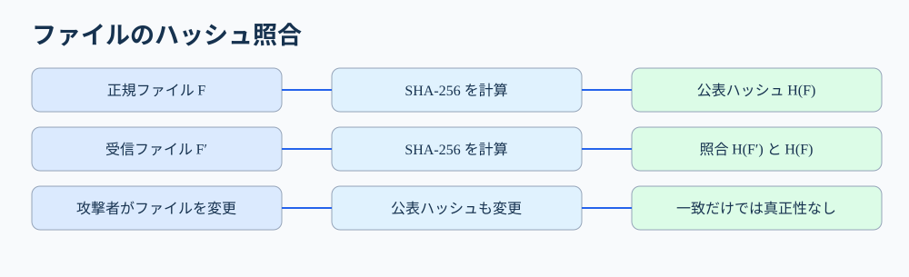
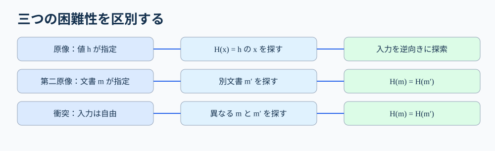
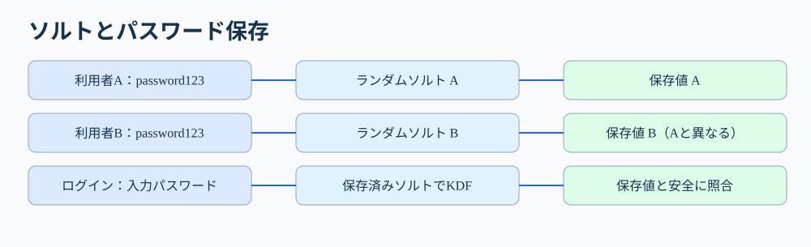

# 第37講　ハッシュ関数

**到達目標**：①ハッシュ関数の性質と三つの困難性を区別できる。②ファイル改ざん検出におけるハッシュ値の信頼の条件を説明できる。③パスワード保存におけるソルトと低速なパスワード用KDFの必要性を説明できる。④科目Bで攻撃の成立条件と対策を具体的に記述できる。

**参考書**：『徹底攻略 情報処理安全確保支援士教科書 令和7年度版』第4章4-1-3「ハッシュ」（印刷267〜269頁）。ハッシュの性質・用途・MD5/SHA・ソルト・HMACの概要は参考書に基づく。三つの困難性の厳密な区別、ハッシュ値配布の信頼性、Argon2id・scrypt・PBKDF2、署名検証の事例は講師の補足。参考書のパスワード保存の説明は入門的な記述であり、実務では単純なSHA-256保存では不十分な点を補足する。

**優先度**：A必須75%（性質、三つの困難性、改ざん検出の条件、ソルト、攻撃と対策）、B理解補助20%（ビット数、計算量、署名との関係）、C発展5%（内部構造、詳細パラメータ）。

## 1. ファイルが「途中で書き換わっていないか」を確かめたい【A】

例えば会社の担当者が、取引先から受け取った更新プログラムをサーバに適用する場面を考えましょう。ダウンロードは成功したように見えても、途中でファイルが破損したり、攻撃者が別のファイルにすり替えたりした可能性があります。全バイトを目で確認するのは現実的ではありません。

そこで、ファイル全体を決まった計算手順に通し、短い「指紋」のような値を求めます。これが**ハッシュ値（ダイジェスト）**です。計算手順が**ハッシュ関数**です。例えばSHA-256なら、入力が数文字でも巨大なファイルでも、出力は256ビット（32バイト）です。通常は16進数64文字で表示します。長いファイルを32バイトに「圧縮して復元する」のではありません。ハッシュ値だけから元のファイルを復元することは想定していません。

送信者がファイルFのハッシュ値H(F)を公表し、受信者が受け取ったファイルF'からH(F')を計算して比較します。一致しなければ内容が異なります。一致すれば、適切なハッシュ関数の下で内容が同じである可能性が非常に高いと判断できます。ただし**一致だけで送信者が本物と証明できるわけではありません**。ここを後で詳しく説明します。



図の左は正規配布者が元ファイルから計算した値、右は利用者が受信ファイルから計算した値です。比較しているのは**ファイルそのものではなく二つのハッシュ値**です。図の下の攻撃者は、ファイルと照合用ハッシュ値を両方差し替えられる場合を示します。比較が一致しても、それだけでは正規配布者が作ったファイルだと保証できません。

## 2. ハッシュ関数の四つの基本性質【A】

**① 同じ入力なら同じ出力（決定性）**。同じファイルを同じSHA-256に通せば、いつ計算しても同じ値になります。乱数を毎回加えて結果が変わる仕組みでは、単純な照合に使えません。

**② 入力の長さにかかわらず出力は一定長**。SHA-256は256ビットです。「256ビットの鍵を使う暗号」とは違います。SHA-256には暗号化用の秘密鍵はありません。

**③ 入力の一部が変わると出力は大きく変わりやすい**。例えばファイルの1ビットが変わっても、出力は大きく変化するよう設計されています。これを雪崩効果と呼びます。ただし、これは衝突が存在しないことを意味しません。

**④ 逆算や都合のよい別入力の発見が困難**。出力値から元の入力を探すこと、同じハッシュ値を生む別の入力を探すことが計算上困難になるよう設計します。「暗号化して鍵で復号する」とは異なり、ハッシュ関数に復号鍵はありません。

重要なのは、**ハッシュは暗号化ではない**ことです。ハッシュ値は原則として誰でも計算できます。秘密にしたいデータをハッシュ化しただけで、機密性が保証されるわけではありません。特に入力が短いパスワードなら、候補を次々にハッシュ化して一致するものを探せます。

## 3. 「一方向」「第二原像」「衝突」は何が違うのか【A】

ハッシュ値の長さが256ビットでも、入力は無数にあります。異なる入力が同じ出力になる**衝突**は数学的に必ず存在します。安全性とは、衝突を「存在させない」ことではなく、攻撃者が実用的に見つけにくいことです。

**原像計算困難性**：ハッシュ値 `h` だけを与えられ、`H(x)=h` となる入力 `x` を探すのが困難。例えばハッシュ値しか分からない攻撃者が、対応する元データを探す場面です。

**第二原像計算困難性**：元の文書 `m` を指定された攻撃者が、`m` とは異なる `m'` で `H(m')=H(m)` を探すのが困難。例えば「この正規契約書と同じハッシュ値になる改ざん契約書を作れ」という場面です。

**衝突発見困難性**：攻撃者が両方の入力を自由に選び、`m≠m'` かつ `H(m)=H(m')` となる二つを探すのが困難。例えば内容の違う二つの文書を先に用意し、同じダイジェストにしたい場面です。



図では、原像は「ハッシュ値から入力を探す」、第二原像は「固定された元文書と同じ値の別文書を探す」、衝突は「二つとも自由に選んで同じ値を探す」と区別しています。**衝突発見は、二つとも自由に選べるぶん、一般に第二原像より攻撃者に有利**です。

理想的なnビットハッシュでは、原像・第二原像探索は概ね2^n回、衝突探索は誕生日のパラドックスにより概ね2^(n/2)回が目安です。SHA-256なら衝突探索の理想的な計算量は約2^128です。これらは理想的なモデルの目安であり、実際の攻撃可能性はアルゴリズムの弱点にも依存します。

## 4. 改ざん検出の落とし穴――照合用ハッシュ値は誰が保証する？【A】

正規配布者が `update.zip` と、そのSHA-256値を配布したとします。利用者がファイルをダウンロードして値を計算し、公表値と一致したら「通信途中で内容が変わっていない」と判断する材料になります。

ところが攻撃者が**配布サイトのページもファイルも書き換えられる**なら、悪意のある `update.zip` とそのハッシュ値を同時に掲載できます。利用者の計算結果は当然一致します。つまりハッシュ値の一致だけでは、**正規の発行者が作ったこと（真正性）**を保証できません。

対策として、正規の公開鍵に基づく**電子署名の検証**、信頼できる配布経路から得たハッシュ値との照合などを使います。HTTPSは通信経路を保護しますが、配布元自体が侵害された場合まで万能ではありません。

科目Bの答案では「ハッシュ値を比較する」だけで終わらず、**照合する正解値が信頼できるか**を確認しましょう。

## 5. パスワード保存――ハッシュ化しても総当たりはできる【A】

サービスが利用者のパスワードを平文でDBに保存していたら、DBを盗まれた時点でパスワードが直接漏えいします。そこで、認証時に照合できるよう、パスワードそのものではなく、変換した値を保存する方式を使います。

しかし、例えば `password123` を単純にSHA-256で変換して保存した場合、攻撃者はよく使われるパスワードの候補を大量に計算して一致を探せます。ハッシュは「逆関数で復号できない」だけで、**候補を試す攻撃を防ぐわけではない**のです。高速なSHA-256はこの総当たりにも高速であることが問題になります。

**ソルト（salt）**は、パスワードごとに生成して一緒に保存するランダムな値です。例えば同じパスワードを設定したAさんとBさんでも、ソルトが違えば保存値が異なります。攻撃者が共通の事前計算表（レインボーテーブル）を使い回すことや、同一パスワードの利用者を保存値だけで見分けることを難しくします。**ソルトは秘密である必要はありません**。ソルト自体をDBに保存しても問題ありません。

ただしソルトだけでは、一人分の候補を高速に総当たりする攻撃は十分に抑えられません。実際のパスワード保存には、**Argon2id、scrypt、PBKDF2などのパスワード保存向けの計算コストを持つ方式**を、適切なパラメータとソルトで使います。Argon2idなどはメモリ使用量も調整できます。これは参考書の「ソルトを付けてハッシュ化する」という入門説明に対する現代的な補足です。



図の上段は同じパスワードでも異なるソルトによって保存値が異なること、下段はログイン時に保存済みソルトと入力パスワードを使って再計算・照合することを示します。ソルトを「ユーザーから入力してもらう秘密鍵」と誤解しないでください。

### ソルトとペッパーの違い【B】

**ペッパー（pepper）**は、パスワード保存値の計算に加える、DBとは別に管理する秘密の値です。ソルトはユーザーごとに異なり公開されてもよいのに対し、ペッパーは秘密管理が必要です。ペッパーの運用には鍵管理が必要なので、まずソルトと適切なパスワード用KDFの理解を優先してください。

## 6. MD5・SHA-1・SHA-2・SHA-3を区別する【A】

| 方式 | 出力長の例 | 試験での判断 |
|---|---|---|
| MD5 | 128ビット | 衝突攻撃に対して安全でなく、署名などの耐衝突性が必要な用途に不適切 |
| SHA-1 | 160ビット | 衝突攻撃に弱く、新たな署名用途などに使用すべきでない |
| SHA-2 | SHA-256、SHA-384、SHA-512など | 現在広く利用される安全なハッシュ関数群 |
| SHA-3 | SHA3-256など | SHA-2と異なる内部設計を持つ安全なハッシュ関数群 |

ここで「SHA-256の出力が256ビットだから256ビットの暗号鍵と同じ強度」と考えるのは誤りです。衝突耐性の理想的な目安は128ビット程度です。また、SHA-3はSHA-2が全面的に危険になったから登場したわけではありません。**SHA-2もSHA-3も用途に応じて利用されます。**

ファイル照合でMD5やSHA-1を見たときは、「古いから常に即座に内容が復元される」とは考えず、**衝突耐性が必要な場面で危険**という性質を正しく説明してください。

## 7. ハッシュ、HMAC、電子署名を混同しない【A】

ハッシュ関数は誰でも同じ値を計算できます。したがって、通常のハッシュ値だけでは送信者が正しいことを証明できません。

**HMAC（Hash-based Message Authentication Code）**は、送信者と受信者が共有する秘密鍵を使ってメッセージ認証コードを計算します。鍵を知らない第三者は正しいHMAC値を作りにくいため、改ざん検出に加えて**共有鍵を知る相手から来たこと**を確認できます。ただし双方が同じ鍵を持つため、第三者に対して「送信者だけが作った」と証明する否認防止には向きません。HMACの内部構造は次の第38講で扱います。

**電子署名**は署名者の秘密鍵で署名し、対応する公開鍵で検証します。公開鍵の持ち主を正しく確認できることが前提ですが、メッセージの完全性と署名者の認証に利用できます。署名は一般にハッシュ値を組み合わせて処理しますが、**ハッシュ値を送るだけで電子署名になるわけではありません**。

| 技術 | 秘密鍵が必要か | できること | それだけではできないこと |
|---|---|---|---|
| ハッシュ | 不要 | 同じ入力かどうかの照合 | 発行者の認証 |
| HMAC | 共有秘密鍵が必要 | 鍵を共有する相手からのメッセージ認証 | 第三者への否認防止 |
| 電子署名 | 署名者の秘密鍵が必要 | 署名の検証、発行者認証 | データ本文の秘匿 |

## 8. ログ・設定から読み取る【A】

次は説明用の擬似ログです。実在製品の出力形式ではありません。

```text
[download] file=update.zip algorithm=SHA-256
[download] expected_digest_source=vendor_signed_manifest
[download] digest_match=true signature_valid=true
[password] scheme=SHA-256 salt=none
[password] db_dump_detected=true
```

前半では、SHA-256の値が一致するだけでなく、**署名付きマニフェストの検証に成功**している点が重要です。マニフェストは、配布ファイル名やハッシュ値をまとめた管理情報です。署名を検証するための正規公開鍵の信頼性も前提です。

後半では、パスワードが高速なSHA-256で、ソルトなしで保存されています。DBダンプ（DB内容の抽出データ）が盗まれた場合、攻撃者が辞書攻撃や事前計算表を利用しやすくなります。**DB漏えいへの対策**は、保存方式をArgon2idなどへ移行し、ソルトと適切なコストを設定することに加え、漏えいした認証情報への対応やDBアクセス制御・監査も必要です。

## 9. 科目Aの判断と科目Bの答案作成【A】

**科目Aで見抜く区別**：ハッシュは復号する暗号ではない／同じ入力は同じ値／衝突は存在するが見つけにくくする／MD5・SHA-1の衝突耐性に問題がある／ソルトは秘密鍵ではない／HMACと署名は認証の仕組みが違う。

**科目B例題①：配布ファイルのハッシュが一致したのにマルウェアを導入した。なぜか。**

判断の順序は、①利用者はファイルと公表ハッシュ値を照合した、②攻撃者はファイルと公表値の両方を改ざんできた、③一致するのは攻撃者が用意した二つの値であり正規性を示さない、④正規発行者の署名付き情報を検証する必要がある、です。

**答案例**：攻撃者が配布ファイルと照合用ハッシュ値を同時に差し替えたため、両者が一致しても正規ファイルであることを確認できなかった。正規発行者の署名を検証したマニフェストなど、信頼できる情報に基づいて照合する。

**科目B例題②：利用者DBからソルトなしのSHA-256パスワード値が漏えいした。なぜ危険で、どう対策するか。**

判断の順序は、①漏えいしたのはハッシュ値、②攻撃者は候補パスワードをSHA-256で計算して照合できる、③ソルトなしでは事前計算を使い回せる、④高速なSHA-256は候補試行を速くする、⑤ソルト付きのパスワード用KDFへ移行する、です。

**答案例**：攻撃者が辞書攻撃や事前計算表で候補のハッシュ値を照合し、元のパスワードを推測できる。利用者ごとに異なるソルトを付与し、Argon2idなどの計算コストを調整できるパスワード保存方式を利用する。

## 10. 今日の整理【A/B/C】

**A：必須**。ハッシュ値は一定長で、入力の差を検出できるが、単独で送信者の真正性を証明しない。原像・第二原像・衝突の三つの困難性を区別する。MD5・SHA-1の衝突耐性に注意する。ソルトとパスワード用KDFの役割を説明する。

**B：理解補助**。SHA-256の衝突探索が理想的には約2^128回である理由、署名付きマニフェスト、ペッパーの役割を理解する。

**C：発展・任意**。SHA-2/SHA-3の内部圧縮関数、Argon2idのパラメータ設計、誕生日攻撃の厳密な確率計算は今回の必須範囲外です。