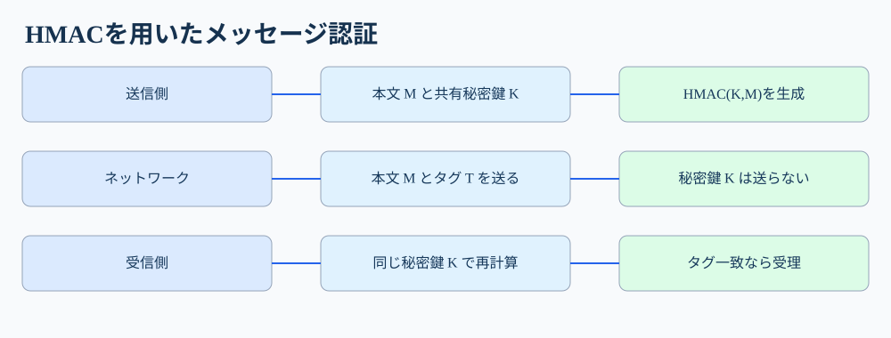
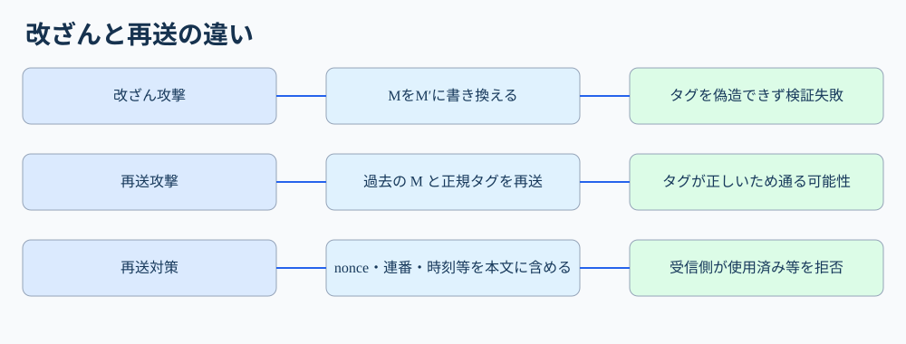
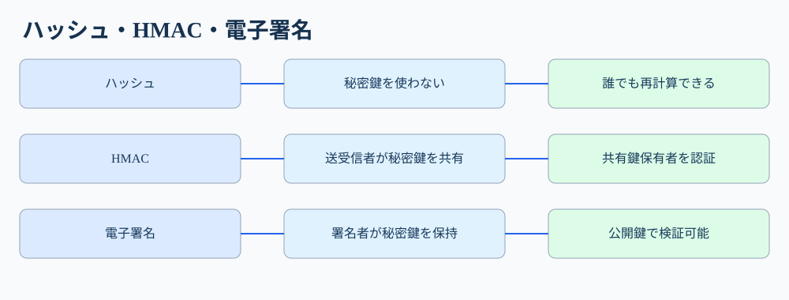

# 第38講「MAC／HMAC」

**第III部 暗号技術／全217講の第38講**

**到達目標**：①通常のハッシュとMACの違いを説明する。②HMACの送受信処理と共有鍵の役割を追う。③改ざん・なりすまし・再送攻撃を区別する。④科目Bで原因・攻撃の手順・影響・対策を書く。

**参考書**：『徹底攻略 情報処理安全確保支援士教科書 令和7年度版』第4章4-2「認証」内「内容認証」「MAC」、印刷283〜284ページ（PDF実確認）。参考書はMACを共有鍵を使うメッセージ認証コード、HMACをハッシュ関数を用いたMACと説明している。以下の具体的な通信例、HMACの構造、再送対策、実装時の注意点は**講師独自の補足**。現代の推奨アルゴリズムと参考書に例示されたMD5/SHA-1は区別する。

**学習優先度**：A（必須）約75％＝MACの目的、HMACの処理、認証範囲、攻撃と防御、科目B答案。B（理解補助）約20％＝HMACの内部構造、APIの具体例、鍵管理。C（任意）約5％＝証明可能安全性やアルゴリズム実装。

## 1. なぜハッシュ関数だけでは足りないのか【A】

前回は、ソフトウェア配布サイトのファイルと公開ハッシュ値を**両方**攻撃者に書き換えられると、照合値が一致しても安全とはいえないと学んだ。今回は、社内システム間の注文APIを考える。店舗サーバAが決済サーバBに「注文番号=731、金額=1000円」というメッセージを送る。AもBも、インターネット上を通るデータが途中で変更されていないか知りたい。

最初にAがメッセージのSHA-256値を添付する方法を考える。Bは受信した本文からSHA-256を再計算し、添付値と比較できる。しかし攻撃者Eが通信を途中で書き換えられるなら、「金額=9000円」に変えた本文から**新しいSHA-256値も自分で計算**して送れてしまう。ハッシュ関数の計算方法は公開されており、Eも実行できるからだ。Bは「受信した本文と添付値が一致した」ことしか確認できず、**Aが作った本文かどうか**は分からない。

では、Eには作れない照合値をAだけが付けられればどうか。AとBだけが知る秘密鍵Kを計算に使い、本文MとKから「認証タグ」Tを作る。EはMを見てもKを知らないので、書き換え後のMに合う正しいTを容易に作れない。これがMAC（Message Authentication Code、メッセージ認証コード）の基本的な発想である。ここでの「認証」は**共有鍵を知る主体が作成したメッセージであることの確認**であって、公開鍵証明書による個人の身元確認とは異なる。

## 2. MACを使った正常時の通信を一段階ずつ追う【A】

登場人物は送信者A、受信者B、盗聴・改ざんを試みる攻撃者Eの三者。AとBは事前に同じ秘密鍵Kを安全な経路で共有しているとする。Kは公開しない。注文データをM、MACの計算を `MAC(K, M)` と書き、その出力を認証タグTと呼ぶ。



**① Aが本文Mを確定する。** 例えば `order=731&amount=1000&currency=JPY` とする。重要なのは、何を認証対象に含めるかを明確にすること。金額だけ認証して注文番号を認証しなければ、注文番号を書き換えられる危険が残る。

**② AがKとMからTを計算する。** 例として `T=HMAC-SHA256(K,M)`。HMACはMACを作る方法の一つで、SHA-256を内部で使う。Tは通常のSHA-256(M)とは異なり、**秘密鍵Kを知らないと正しい値を生成しにくい**。ここでは計算結果を短縮して `T=8F3A…` と表記するが、実際のタグはもっと長い。

**③ AがMとTをBへ送る。** ネットワーク上を流れるのは本文MとタグT。**Kは送らない**。暗号化を別途行わなければ、Eは本文Mを読むことができる。MACは本文を隠す技術ではない。

**④ Bが受信した本文M'を、手元の同じKで再計算する。** Bは `T'=HMAC-SHA256(K,M')` を求め、受信したTと安全な比較処理で照合する。AとBでKとMが同じなら計算結果も同じになる。もし途中で金額が書き換えられたなら、Bが計算するT'は通常、元のTと一致しない。

**⑤ Bは一致なら認証に成功、不一致なら拒否する。** 一致は「そのKを知る主体が作った可能性が高く、対象本文は変更されていない」ことを意味する。ただしAとBが同じKを知るため、第三者に対して「必ずAだけが作成した」と証明することはできない。またKが漏えいすればEもタグを偽造できる。**MACの安全性は鍵の秘密保持に依存する。**

## 3. MACとHMACの関係、ハッシュとの違い【A・B】

**MACは目的を表す一般名**である。共有秘密鍵を使ってメッセージの完全性と共有鍵保有者による認証を行う仕組み全般を指す。**HMACはハッシュ関数を使ってMACを実現する具体的な方式**である。つまり、すべてのHMACはMACだが、すべてのMACがHMACではない。AESを使うCMACなど、ハッシュ以外を基にするMACもある。

前回の `SHA-256(M)` は鍵を使わないので、誰でも同じ値を作れる。一方 `HMAC-SHA256(K,M)` は秘密鍵Kを計算に使う。ここで「ハッシュ値に秘密鍵をただ付け足してSHA-256に入れるだけ」と理解してはいけない。HMACには鍵を内側と外側の二段階で組み合わせる**規定の構造**がある。安全性を確保するための構造なので、独自に `SHA-256(K || M)` のような方式を設計してHMACの代わりにしない。

B（理解補助）として、HMACの形を示す。

`HMAC(K,M) = H((K0 XOR opad) || H((K0 XOR ipad) || M))`

ここでHはSHA-256などのハッシュ関数、K0は所定のブロック長に整えた鍵、`||` はデータの連結、XORはビットごとの排他的論理和、ipadとopadは規格で定められた異なる定数である。内側の計算結果を外側の計算に組み込む二段構造だと分かればよい。**ipadやopadの具体的なバイト列を暗記する必要はない**。実装では標準ライブラリのHMAC関数を使う。

## 4. 攻撃者は何を変更でき、何をできないか【A】

### 4-1. 本文改ざんとタグ偽造

Eが `amount=1000` を `amount=9000` に変更して送ったとする。元のタグTをそのまま添えれば、Bの再計算結果と一致せず拒否される。Eが変更後の本文に合わせたタグを作ろうとしても、秘密鍵Kが分からなければ適切なHMACを計算できない。**攻撃の成立条件**は、Kの漏えい、認証処理の無効化、認証対象外の重要項目の存在などである。

ただしMACは**機密性を提供しない**。EはMとTを盗聴できる場合がある。本文を秘密にしたければTLSなどで暗号化も必要となる。MACと暗号化は役割が異なる。

### 4-2. 正規タグの付いた過去メッセージをそのまま再送する

ここが重要である。EはKを知らなくても、Aが以前送った**正規のMとTの組**を記録できる。Eが同じ組を後日再送したら、Bが計算するHMACは元のTと一致する。本文もタグも書き換えていないからである。

例えば「口座XからYへ1000円送金する」という正規の依頼をEが記録し、そのまま再送すると、Bの設計次第では同じ送金を二回処理してしまう。これは**再送攻撃（リプレイ攻撃）**である。HMACが破られたのではなく、HMACが保証する「本文の認証」と、アプリケーションが必要とする「新しい要求であること」は別の性質なのだ。



対策には、要求ごとに異なる**ノンス（nonce、一度限りの値）**、単調増加するシーケンス番号、許容時間を設けたタイムスタンプなどを使う。これらの値も**MACの認証対象に含める**。さらに受信側Bは、使用済みノンスを記録して再利用を拒否する、既に処理した番号を拒否する、時刻の許容範囲を検査するなどの状態管理が必要だ。**ノンスを付けるだけでは再送を防げない**。Bが使用済みか確認しなければ、Eは同じノンス付きの正規メッセージを再送できる。

時刻だけの対策にも限界がある。許容時間内なら同じメッセージを再送できるため、重要な取引では一意な取引IDや重複処理防止と組み合わせる。

### 4-3. 秘密鍵が漏えいした場合

EがKを盗んだら、変更したMに対して正しいタグTを計算できる。Bはタグが一致しただけではEの偽造を見分けられない。したがってKは安全に配布・保存し、不要な主体に共有しない。鍵の漏えいが疑われたら交換し、古い鍵での認証を停止する。複数の取引先に同じ鍵を共有すると、一社の漏えいが他社にも影響し得るので、主体・用途ごとに鍵を分離する。

## 5. ハッシュ・HMAC・電子署名の比較【A】



| 技術 | 秘密情報 | 検証者 | 主な保証 | 保証しないもの |
|---|---|---|---|---|
| SHA-256など通常のハッシュ | なし | 誰でも計算できる | 信頼できる照合値との一致 | 発信者の認証、秘匿性 |
| HMAC | 送受信者が共有するK | Kを知る者 | Kを知る主体が作成したメッセージの完全性・認証 | 秘匿性、第三者に対する否認防止、再送防止 |
| 電子署名 | 署名者だけが秘密鍵を保持 | 対応する公開鍵を持つ者 | 署名者の認証、改ざん検出 | 秘匿性、単独での再送防止 |

電子署名の公開鍵は正規の署名者に対応していると確認できる必要がある。HMACはAもBもKを持っているため、B自身も正しいタグを生成できる。したがって第三者に「このメッセージは絶対にAが作成した」と証明する**否認防止**には向かない。これが次回のデジタル署名との重要な違いである。

## 6. 具体的なAPI設計と擬似ログ【A】

次は説明用のHTTP API例で、特定製品の実際のログではない。

```text
POST /transfer HTTP/1.1
X-Request-Id: 008731
X-Timestamp: 2026-10-29T07:00:00+09:00
X-Signature: hmac-sha256=<計算した認証タグ>

{"from":"A","to":"B","amount":1000}
```

この例では、送信側はHTTP本文だけでなく、`X-Request-Id` と `X-Timestamp` も規定された順序・表現で結合し、その全体に対してHMACを計算すると仮定する。受信側も**全く同じバイト列**を作って再計算する。JSONの空白やフィールド順序、改行などの扱いが違うとタグが一致しない場合があるため、どのデータをどの順序で認証するかという仕様が必要だ。

```text
07:00:01 request_id=008731 hmac_valid=true nonce_unused=true accepted=true
07:00:05 request_id=008731 hmac_valid=true nonce_unused=false accepted=false reason=replay
07:01:02 request_id=008732 hmac_valid=false accepted=false reason=tag_mismatch
```

**1行目**：タグが一致し、未使用の要求IDなので処理する。**2行目**：タグは一致しているが、同じ要求IDを再送したため拒否する。**3行目**：本文またはタグが一致せず拒否する。3行目だけで「必ず攻撃」と断定せず、鍵の設定違い、データの正規化不一致、通信中の破損なども確認する。

HMACのタグ比較では、入力内容によって比較処理時間が変わりにくい**定数時間比較**を用いるのが望ましい。これは高度な実装の詳細に属するが、試験では「単純な文字列比較で十分と決めつけない」程度の理解でよい。HMAC自体の計算と再送防止は別の処理であり、両方のログを確認する。

## 7. 科目Aの典型論点と科目Bの答案作成【A】

**科目A**では「HMACはハッシュを用いるMAC」「共有鍵が必要」「本文を暗号化しない」「再送攻撃はHMACの一致だけでは防げない」「否認防止には向かない」を区別する。MACが一致したときに何が保証され、何が保証されないかを問われたら、**認証対象に含まれるデータ**と**鍵の管理条件**を考える。

### 科目B例題①：HMACを付けているのに送金が二重処理された

**観測事実**：サーバはHMACの一致を確認している。ログには同じ要求IDの送金が二度成功した記録がある。**攻撃条件**：Eは正規のMとTを記録できる。**原因**：Bはタグを検証しても、過去の要求IDを再利用していないか検査していない。**影響**：Eが正規の組を再送し、送金が重複処理される。**対策**：要求IDを認証対象に含め、受信側で処理済みIDを記録して再利用を拒否する。これにより同じ正規タグ付きメッセージでも二回目は処理されない。

**答案例**：「攻撃者が過去の正規の要求とHMACタグをそのまま再送しても検証に成功するため、送金が重複実行される。要求IDをHMAC対象に含め、受信側で処理済みIDの再使用を拒否する。」

### 科目B例題②：金額を改ざんしても検証を通過した

**観測事実**：送信者は注文番号だけにHMACを付け、金額を認証対象に含めていなかった。**原因**：HMACは認証対象のバイト列しか保護しない。**攻撃の操作**：Eは注文番号とタグを維持し、認証対象外の金額だけを変更する。**影響**：受信側はタグ一致と判断し、改ざん後の金額を処理する。**対策**：注文番号・金額・通貨など重要なフィールドをすべて明確な形式で認証対象に含める。

**答案例**：「HMACの対象外だった金額を攻撃者が変更しても、注文番号に対するタグは一致する。金額を含む取引の重要項目をHMACの認証対象に追加する。」

## 8. 要点整理と発展の切り分け

**A（必須）**：MACは共有秘密鍵を用いてメッセージの完全性と共有鍵保有者による認証を確認する仕組み。HMACはハッシュ関数を用いたMAC。送信者が `HMAC(K,M)` を作り、受信者が同じKと受信Mから再計算して比較する。Kは送らない。本文の秘匿、再送防止、第三者に対する否認防止はHMACだけでは実現しない。再送対策はノンス・要求ID等を認証対象に含め、受信側で重複拒否する。

**B（理解補助）**：HMACの内側・外側の二重構造、認証対象のバイト列の統一、鍵の用途別分離を理解する。

**C（任意）**：HMACの証明可能安全性、定数時間比較の具体的実装、KDFやプロトコルごとの鍵導出の詳細は後回しでよい。

**次は理解度チェック**。選択式6問×1点、記述式3問×3点の合計15点。回答前に正解は示さない。