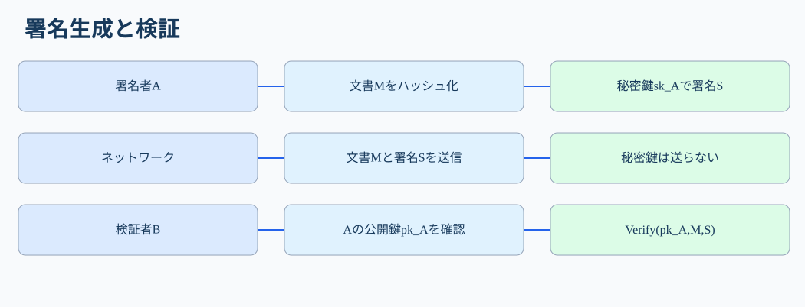
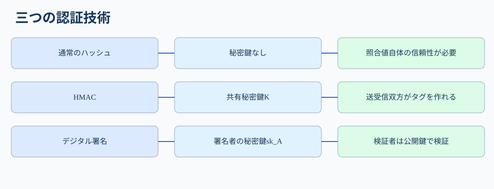
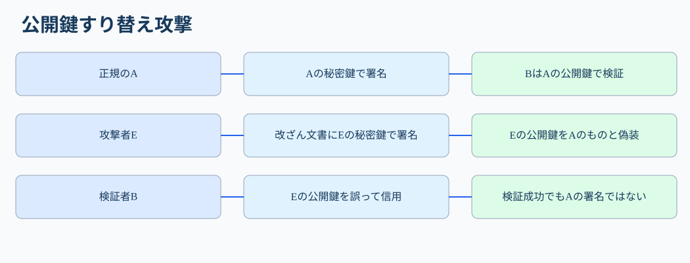

# 第39講「デジタル署名」

**第III部・暗号技術／全217講の第39講**

**到達目標**：①署名生成と検証の主体・鍵・データを順に説明する。②完全性・真正性・否認防止と、署名だけでは保証しないことを区別する。③公開鍵のすり替え、署名対象外データの改ざん、秘密鍵漏えいを分析する。④RSA-PSS・ECDSA・DSAを試験で識別する。⑤科目Bで攻撃の操作と対策まで記述する。

**参考書**：『徹底攻略 情報処理安全確保支援士教科書 令和7年度版』第4章「情報セキュリティ基礎技術（暗号化，認証）」4-2「認証」の「デジタル署名」、印刷273～274ページ（PDFを実確認）。署名者の秘密鍵と検証者の公開鍵、ハッシュとの組合せ、RSA・DSA・ECDSAが参考書の基礎事項。以下の契約API、攻撃例、検証ログ、RSA-PSSの厳密な説明は**講師独自の補足**。証明書の信頼経路の詳細は次講以降で扱う。

**学習配分**：A（必須）約75%：署名・検証、鍵とハッシュ、脅威・対策、科目A/B。B（理解補助）約20%：署名方式と実装例。C（任意）約5%：パディング・楕円曲線の数学。

## 1. なぜHMACではなくデジタル署名が必要なのか【A】

第38講では、店舗サーバAと決済サーバBが**同じ秘密鍵K**を共有し、本文Mから `HMAC(K,M)` を作って照合した。通信途中の第三者はKを知らなければタグを偽造しにくい。しかしBもKを知っている。後日、Aが「その注文を送っていない」と主張したとき、第三者はAとBのどちらがタグを作ったかを区別できない。HMACは共有鍵を持つ相手の認証には役立つが、**署名者だけが作成できる証拠**にはならない。

例として、企業Aが取引先Bに「契約金額は100万円」と書かれた電子契約書を送る。Bは改ざんされていないことに加え、Aが署名したことを後から確認したい。ここで使うのが**デジタル署名（digital signature）**である。Aだけが管理する**署名用秘密鍵**で署名し、Bは対応する**公開鍵**で検証する。公開鍵は検証に使えるが、適切な署名方式なら公開鍵だけで新しい正当な署名を作ることは計算上困難である。

ただし「Aの公開鍵」と称する鍵が本当にAのものかを確認しなければ、攻撃者の鍵を使った偽の署名を受け入れる。署名の数学的な検証成功と、現実の本人確認は区別する。

## 2. 正常時の署名生成・送信・検証【A】

登場人物は、**署名者A**、**検証者B**、通信途中で改ざんを試みる**攻撃者E**。Aは鍵ペア（秘密鍵 `sk_A`、公開鍵 `pk_A`）を生成し、`sk_A` を秘密に保持する。Bは、`pk_A` がAのものだと信頼できる方法で確認しているとする。対象文書をM、ハッシュ関数をHとする。



**① Aが署名対象の文書Mを確定する。** 例：`契約番号=731; 金額=1000000円; 支払先=B`。文書の一部だけに署名すると、署名対象外の支払先などが変更されても検出できない。署名対象の範囲とバイト表現を決める必要がある。

**② Aが文書のハッシュ値を計算する。** 例えば `h = SHA-256(M)`。ハッシュ値は文書内容を代表する固定長の値だが、ハッシュだけでは署名者を認証できないことを第37講で学んだ。

**③ Aが署名用秘密鍵で署名値Sを生成する。** 概念的には `S = Sign(sk_A, M)`。多くの署名方式では内部でハッシュ値を用いる。実際のRSA-PSSやECDSAは規定の署名アルゴリズムに従い、**単純に「ハッシュ値を秘密鍵で暗号化する」処理と同一ではない**。参考書の「秘密鍵でハッシュ値を暗号化」は仕組みをつかむための概念的説明として理解する。

**④ AがMとSをBに送信する。** `sk_A` は送信しない。`pk_A` は公開してよいが、その正当性を確認する仕組みが必要である。署名を付けてもM自体は平文のまま送れるため、**署名だけでは機密性を保証しない**。

**⑤ Bが正しい公開鍵で検証する。** `Verify(pk_A, M, S)` が成功するか確認する。検証処理では署名方式に応じてMのハッシュなどが用いられる。文書Mの一文字でも変更されれば、適切な方式では検証に失敗する。署名検証が失敗した文書を受理しない。

**⑥ Bが検証結果を業務判断に結び付ける。** 署名が正しくても「契約金額が妥当」「送金が承認済み」「署名鍵が失効していない」といった業務条件まで自動的に満たすわけではない。署名検証、鍵・証明書の信頼性、権限・承認の確認を別々に行う。

## 3. デジタル署名が提供する性質と限界【A】

| 性質 | 署名でできること | 注意すべき限界 |
|---|---|---|
| 完全性 | 署名対象データの変更を検出できる | 対象外の項目は保護されない |
| 署名者の真正性 | 対応する秘密鍵の保有者が署名したことを確認できる | 公開鍵の帰属確認と秘密鍵管理が必要 |
| 否認防止への寄与 | 署名者しか秘密鍵を持たない前提で、後から署名を否定しにくくする | 秘密鍵漏えい・代理署名・法的証拠評価等は別途考慮 |
| 機密性 | **提供しない** | 本文の秘匿には暗号化が必要 |
| 新鮮性・再送防止 | **自動では提供しない** | 時刻、取引ID、ノンス、使用済み確認等が必要 |

### 3-1. HMACとの決定的な違い

HMACではAとBが同じKを知り、**両者がタグを作れる**。署名ではAが `sk_A` を保持し、Bは通常 `pk_A` しか持たない。Bは検証できるが、Aになり代わって新しい正当な署名を作れない。この鍵の非対称性が否認防止への寄与の根拠である。



### 3-2. 「公開鍵で復号する」は正しいか

試験参考書では「秘密鍵でハッシュ値を暗号化し、公開鍵で検証」と説明されることがある。しかし現代の署名アルゴリズムは一般に**署名生成と署名検証**という別の演算として理解する。ECDSAは楕円曲線上の計算であり、秘密鍵で暗号化した値を公開鍵で復号する仕組みではない。RSA-PSSも専用の符号化・検証規則を持つ。科目Bでは「署名者の秘密鍵で署名し、対応する公開鍵で検証する」と書くのが正確で汎用的である。

## 4. 攻撃シナリオ①：文書と署名を両方差し替えた【A】

攻撃者Eが契約書Mを「100万円」から「900万円」に変更したとする。EがAの署名Sをそのまま付けても、Bの `Verify(pk_A, M', S)` は失敗する。なぜなら署名対象Mと受信文書M'が一致しないためである。

そこでEは、自分の秘密鍵 `sk_E` で改ざん文書M'に署名S'を作り、**自分の公開鍵 `pk_E` を「Aの公開鍵」と偽って**Bへ渡した。Bが公開鍵の帰属を確認せず `Verify(pk_E, M', S')` だけ実行すると、検証は成功し得る。だが、それはEの鍵による署名が正しいというだけで、Aの署名を意味しない。



**対策**：信頼できる経路で取得したAの公開鍵、または認証局が発行した証明書を検証し、署名者の身元・鍵の対応関係を確認する。証明書を使う場合は有効期間、失効、信頼できる発行者、署名対象の用途などの確認が必要となる。これらの詳細はPKI講義で扱う。

## 5. 攻撃シナリオ②：署名対象外の金額を書き換えた【A】

電子注文のデータが `注文番号=731, 金額=1000, 支払先=B` であるのに、署名対象を注文番号だけにしていたとする。Eが金額を9000円に変更しても、Bが注文番号のみを検証する設計なら署名検証に成功してしまう。暗号アルゴリズム自体に欠陥がなくても、**署名対象範囲の設計不備**で改ざんを見逃す。

**対策**：金額・支払先・注文番号・通貨など、取引判断に使う重要項目を署名対象に含める。JSON/XMLなどでは表記順序や空白の扱いが違うと同じ意味でも異なるバイト列になるため、必要に応じて正規化（canonicalization）を行い、送受信者が同一の署名対象バイト列を使う。

## 6. 攻撃シナリオ③：正規の署名付き要求を再送した【A】

第38講と同じ落とし穴である。EはAが正規に署名した「1000円送金」の本文Mと署名Sを記録し、後日そのまま再送する。Bが署名だけを検証すると、**正規のMとSなので検証は成功**する。使用済み取引の検査がなければ二重送金が起こり得る。

**対策**：一意な要求ID・ノンス・有効期限などを**署名対象に含め**、受信側で使用済みIDや期限切れ要求を拒否する。時刻だけでは許容時間内の再送を防ぎ切れないため、取引IDによる重複実行防止が重要である。

## 7. 攻撃シナリオ④：秘密鍵漏えいと署名の信頼性【A】

Aの署名用秘密鍵 `sk_A` が盗まれると、EはAの公開鍵で検証に成功する偽署名を作れる。これは、通常の公開鍵すり替えと異なり、**正しいAの公開鍵を使っても検証が成功してしまう**深刻な状況である。

**対策**：秘密鍵へのアクセス制御、必要に応じたHSM等による鍵保護、鍵の失効・交換、証明書の失効情報の確認、事故時の署名時点や鍵管理記録の調査が必要。署名検証に成功したという事実だけでは、秘密鍵漏えい後に本当にAが操作したかを断定できない。

## 8. RSA-PSS・DSA・ECDSA【A/B】

| 方式 | 何に基づくか | 試験での着眼点 |
|---|---|---|
| RSA署名／RSA-PSS | RSAの数学的構造 | RSA-PSSは署名用の安全な符号化方式を使う。RSA暗号化とRSA署名を混同しない |
| DSA | 離散対数問題 | デジタル署名専用の方式。暗号化方式ではない |
| ECDSA | 楕円曲線上の離散対数問題 | 楕円曲線を用いた署名方式。ECDHEの鍵共有とは用途が違う |

**ECDSAとECDHEの混同に注意**：ECDSAは「署名する／検証する」技術、ECDHEは「一時鍵を使って共有秘密を合意する」技術である。両者とも楕円曲線を使うことがあるが、役割は別。TLS 1.3ではECDHEによる鍵共有と、RSA-PSSやECDSA等によるサーバ認証が組み合わされ得る。

**B：理解補助**：RSA-PSSは単純なRSAのべき乗計算ではなく、確率的なパディングを含む署名方式。ECDSAでは署名ごとの一時値（nonce）の安全な生成が重要で、使い回しや漏えいが秘密鍵の危殆化につながる。内部計算式の導出はC（任意）。

## 9. ログ・設定例で判断する【A】

次は**講師作成の擬似ログ**であり、特定製品の実ログではない。

```text
2026-11-03T09:00:00 contract=731 signature_valid=true signer_cert_trusted=true signer_key_revoked=false accepted=true
2026-11-03T09:01:00 contract=732 signature_valid=true signer_cert_trusted=false accepted=false reason=untrusted_signer
2026-11-03T09:02:00 contract=733 signature_valid=false accepted=false reason=content_modified
2026-11-03T09:03:00 contract=731 signature_valid=true signer_cert_trusted=true accepted=false reason=duplicate_request
```

**1行目**：署名検証、署名者の鍵の信頼性、失効確認に成功し、業務上も受理している。**2行目**：署名値の数学的検証が成功しても、署名者の証明書を信頼できないため拒否。**3行目**：文書改ざん、署名不一致、実装上のバイト列の差などが疑われるが、ログだけで攻撃と断定しない。**4行目**：署名は正しくても同じ契約番号の再利用を検知し、重複処理を拒否した。

設定レビューでは、①署名検証失敗時に必ず拒否するか、②公開鍵の帰属を確認するか、③金額等の重要項目が署名対象か、④重複要求を拒否するか、⑤秘密鍵を安全に管理しているか、を分けて確認する。

## 10. 科目A・科目Bの答案作成【A】

**科目Aの判断**：送信者の秘密鍵で署名し、送信者の公開鍵で検証する。署名だけでは機密性・再送防止を実現しない。HMACは共有鍵なので否認防止には向かない。RSA-PSS・ECDSAは署名方式、ECDHEは鍵共有方式である。

**科目B例題①：署名検証成功なのに偽契約書を受け入れた。**

設問条件：Bは通信で渡された公開鍵をそのまま信用していた。Eは改ざん文書に自分の秘密鍵で署名し、自分の公開鍵をAのものと偽って送った。

**答案例**：「攻撃者が改ざん文書に自身の秘密鍵で署名し、公開鍵もAのものと偽って渡したため、Bは署名値の検証に成功しても署名者を誤認した。信頼できる認証局の証明書等で公開鍵とAの対応を検証する。」

**科目B例題②：署名付き送金を二度実行した。**

設問条件：署名検証のみ行い、処理済み要求IDを記録していない。

**答案例**：「攻撃者が過去の正規の署名付き送金要求をそのまま再送すると、署名は有効なため検証を通過し、二重送金される。要求IDを署名対象に含め、受信側で処理済みIDを記録して再使用を拒否する。」

**科目B例題③：金額改ざんを検出できない。**

**答案例**：「署名対象が注文番号だけなので、攻撃者が署名対象外の金額を変更しても検証が成功する。金額と支払先を含む重要項目全体を署名対象とする。」

## 11. 重要事項と発展学習の切り分け

**A：必須**：署名者の秘密鍵で署名、対応する公開鍵で検証。ハッシュとの組合せ、完全性・真正性・否認防止への寄与。公開鍵帰属の確認、署名対象範囲、再送防止、秘密鍵管理。科目Bは「原因→攻撃者の操作→影響→対策」を具体的に書く。

**B：理解補助**：RSA-PSS・DSA・ECDSAの役割とECDHEとの違い、データ正規化、証明書の基本。

**C：任意**：RSA-PSSの符号化詳細、ECDSAの数式、証明書パス検証アルゴリズムの細部。