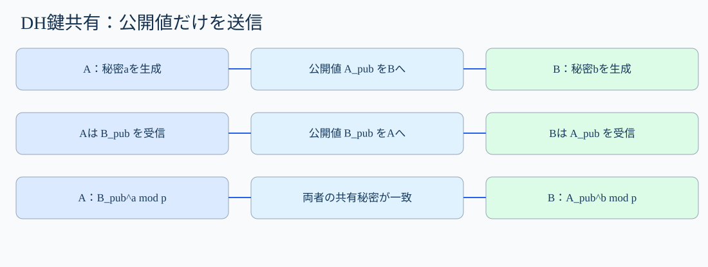
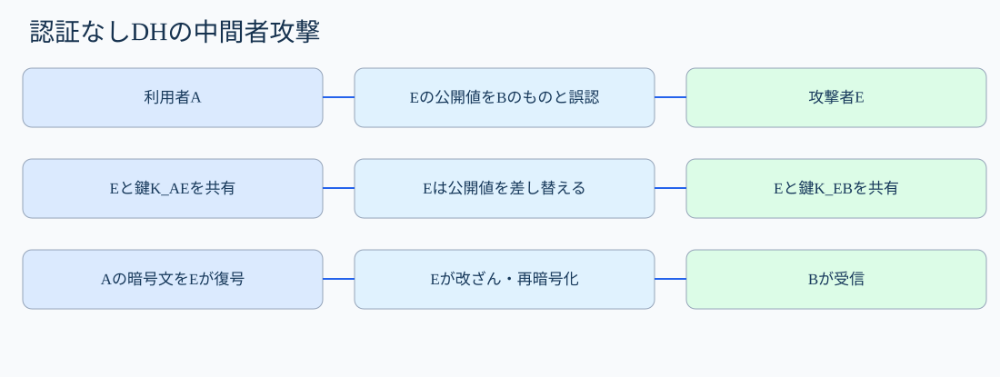
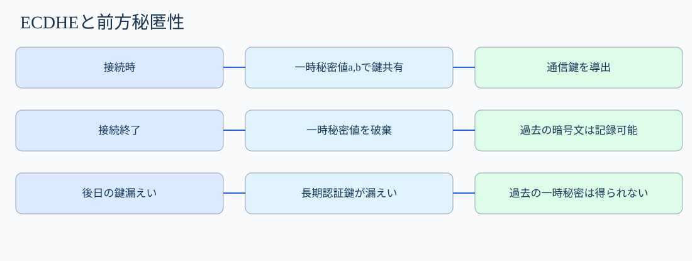

# 第40講「鍵交換」

**第III部・暗号技術／全217講の第40講**

**到達目標**：①鍵配送と鍵共有を区別する。②DH/ECDHEで送受信する値・秘密にする値・共有秘密の一致理由を説明する。③MITM攻撃と認証対策、前方秘匿性を説明する。④科目Bで攻撃手順と対策を記述する。

**参考書**：『徹底攻略 情報処理安全確保支援士教科書 令和7年度版』第4章4-1「暗号化」内「公開鍵暗号方式の種類」、印刷265〜266ページのDH・ECDH・ECDHE、ならびに第6章のTLS「鍵交換（鍵共有）」、印刷380ページ。いずれも参考書PDFを実際に確認した。DHの数値例、MITMシーケンス、擬似ログ、TLS 1.3の整理は**講師独自の補足**である。

**学習優先度**：A必須75％＝鍵共有の処理・MITM・認証・前方秘匿性・科目B。B理解補助20％＝数学的直観・TLSとの対応。C任意5％＝群・曲線の実装詳細。

## 1. なぜ鍵交換が必要なのか【A】

前回のデジタル署名は、署名者の秘密鍵で署名し、相手が公開鍵で検証する技術だった。では、二人が大量の通信内容をAESなどの**共通鍵暗号**で暗号化したいとき、その共通鍵はどう決めればよいだろうか。

例えばブラウザAとWebサーバBがHTTPSで接続する。両者が同じセッション鍵を持てば、Aが暗号化したデータをBが復号できる。ところが、まだ安全な通信路がない段階でセッション鍵そのものを平文送信すれば、盗聴者Eにも鍵が分かり、通信を解読されてしまう。

事前に共通鍵を安全に配布する方法もあるが、インターネット上の多数の利用者それぞれに鍵を手渡しするのは現実的でない。そこで、**秘密の値をそのまま送らず、通信相手と共通の秘密を計算する**鍵共有方式が必要になる。

「鍵交換」という慣用語は広く使われるが、DHは完成した鍵を相手へ渡すというより、双方が計算によって同じ秘密を得る**鍵共有（key agreement）**である。なお、実際の通信鍵は得られた共有秘密をそのまま使わず、KDF（鍵導出関数）に通して作ることが多い。

## 2. DH鍵共有を一段階ずつ追う【A】

登場人物はA、B、盗聴者E。まず、公開してよい共通の数値pとgを決める。Aは秘密の数a、Bは秘密の数bをそれぞれ生成する。**aとbは絶対に送信しない。**

1. Aは公開値 `A_pub = g^a mod p` を計算してBへ送る。
2. Bは公開値 `B_pub = g^b mod p` を計算してAへ送る。
3. Aは受信した `B_pub` を自分の秘密aで計算し、`(B_pub)^a mod p` を得る。
4. Bは受信した `A_pub` を自分の秘密bで計算し、`(A_pub)^b mod p` を得る。
5. どちらも `g^(ab) mod p` になるので、**秘密a・bを送らずに同じ共有秘密を得る**。



図の左側はAが秘密aを保持して公開値を作る流れ、右側はBが秘密bを保持する流れ。中央の通信路には公開値だけが流れ、秘密a・bは流れない。最後にそれぞれの秘密と相手の公開値を組み合わせて同じ結果を得る。

### 数値を入れて確認する【B】

仕組みを確認するためだけの小さな数を使う。実運用には**全く安全でない数値**である。

- 公開値：`p=23`, `g=5`
- Aの秘密：`a=6`、公開値：`5^6 mod 23 = 8`
- Bの秘密：`b=15`、公開値：`5^15 mod 23 = 19`
- Aの計算：`19^6 mod 23 = 2`
- Bの計算：`8^15 mod 23 = 2`

両者は同じ値2を得た。盗聴者Eはp、g、8、19を見られる。しかし現実の十分大きな適切なパラメータでは、公開値から秘密指数を求める離散対数問題が計算上困難であり、共有秘密を求めることも困難になるよう設計されている。**小さい数の例で安全性まで証明したわけではない。**

## 3. DHだけでは相手が本物か分からない【A】

ここがSC試験で重要な落とし穴である。Aが受け取った公開値が、本当にBの公開値だとどう確認するのだろうか。

攻撃者EがAとBの通信を中継し、公開値を差し替えられるとする。

1. AはBへ自分の公開値を送るが、Eが横取りする。
2. Eは**E自身の公開値**をBへ送り、Aのものだと思わせる。
3. BがAへ返した公開値もEが横取りし、別のEの公開値をAへ送る。
4. Aは「Bと共有した」と思いながら、実際にはEとの共有秘密を計算する。Bも「Aと共有した」と思いながらEとの別の共有秘密を計算する。
5. EはAからの暗号文をA-E間の鍵で復号し、必要なら改ざんし、E-B間の鍵で再暗号化してBへ送れる。



この攻撃を**MITM（Man-in-the-Middle、中間者攻撃）**という。DHの数学的性質が破られたわけではない。**交換した公開値と通信相手の身元を結び付けて認証していなかった**ことが原因である。

対策は、交換した鍵共有用公開値やハンドシェイク内容を**認証されたデジタル署名等に結び付ける**こと。TLSではサーバ証明書を検証し、ハンドシェイクの署名等によって鍵共有の内容と正規サーバを結び付ける。証明書の名前・信頼経路・有効期間などの検証を省略すれば、攻撃者の鍵を正規のものと誤認し得る。

**重要**：「DHを使えば盗聴者に共有秘密を計算されにくい」と「接続相手が本物である」は別の主張である。認証のないDHはMITMを防げない。

## 4. DHE・ECDHEと前方秘匿性【A】

**DHE（Ephemeral Diffie-Hellman）**は通信ごとに一時的なDH鍵を使う方式、**ECDHE（Elliptic Curve Diffie-Hellman Ephemeral）**は楕円曲線を用いた一時鍵による鍵共有方式である。楕円曲線とは、特定の数学的な点の演算を利用する仕組みで、DHと同じ目的を異なる数学的構造で実現する。

**Ephemeral（エフェメラル）**は「一時的」という意味で、接続ごとに新しい秘密値を生成する点が重要だ。鍵共有用の秘密値を長期に使い回さず、不要になったら安全に破棄する。

**前方秘匿性（Forward Secrecy）**とは、後日サーバの**長期認証用秘密鍵**が漏えいしても、それだけでは過去に記録された暗号通信を解読できない性質を指す。

なぜだろうか。TLSのECDHEでは、通信時に一時秘密値を使って共有秘密を計算し、そこから通信鍵を導出する。サーバ証明書に対応する長期秘密鍵は**認証**に使うが、ECDHEの一時秘密値そのものではない。したがって、過去の通信を録音した攻撃者が後から長期署名鍵を盗んでも、破棄された過去の一時秘密値までは得られず、過去の通信鍵を計算できない。

ただし、通信中のセッション鍵そのものが漏えいした場合、端末が侵害されて平文を盗まれた場合、一時秘密値が適切に生成・消去されなかった場合などまで守る性質ではない。



**混同注意**：ECDSAは署名方式、ECDHEは鍵共有方式。サーバ証明書の公開鍵とECDHEの一時公開鍵は、用途が異なる。

## 5. TLSの通信で何が起こるか【A/B】

TLS 1.3の典型例を簡略化して追う。TLS 1.3では通常、ECDHEなどで共有秘密を合意し、証明書と署名等でサーバを認証し、導出した共通鍵で通信を保護する。実際のメッセージや鍵導出はもっと細かい。

1. **ClientHello**：ブラウザが対応方式と鍵共有用の公開値（key_share）などを送る。
2. **ServerHello**：サーバが選択方式と自分の鍵共有用公開値を返す。両者はECDHEの共有秘密を計算できる。
3. **鍵導出**：共有秘密などをHKDF（HMACを利用した鍵導出関数）に通して、ハンドシェイクや通信に使う鍵を段階的に導出する。
4. **サーバ認証**：サーバ証明書を検証し、CertificateVerify等の署名によってハンドシェイクと認証用鍵を結び付ける。Finishedメッセージでハンドシェイク内容の整合性も確認する。
5. **暗号化通信**：認証と鍵確認が成功してから、導出した通信鍵でアプリケーションデータを保護する。

TLS 1.2以前の説明ではRSA鍵輸送方式が登場する。これはクライアントが生成した秘密をサーバのRSA公開鍵で暗号化して送る方式で、**DHの鍵共有とは仕組みが異なる**。TLS 1.3では静的RSA鍵輸送を使用しない。RSA-PSSなどのRSA署名は別の用途で利用できる。

## 6. ログと設定から原因を判断する【A】

次は**講師作成の擬似ログ**であり、特定製品の実ログではない。

```text
09:00:01 tls_version=1.3 key_exchange=X25519 cert_valid=true handshake=success
09:01:12 tls_version=1.3 key_exchange=X25519 cert_valid=false reason=hostname_mismatch handshake=failed
09:02:31 tls_version=1.3 key_exchange=X25519 cert_valid=false reason=untrusted_issuer handshake=failed
09:03:05 tls_version=1.3 key_exchange=X25519 cert_valid=true handshake=success
```

**1行目**：X25519（楕円曲線Curve25519を用いたECDHの方式）で鍵共有し、証明書検証にも成功した。

**2行目**：証明書のホスト名が接続先と一致しない。鍵共有の計算自体ができても、正規の相手だと確認できないため失敗させる。

**3行目**：証明書の発行者を信頼できない。攻撃の可能性はあるが、設定ミスでも発生する。ログだけでMITMと断定しない。

**4行目**：正常な接続。鍵共有方式の表示だけでは証明書の信頼性やアプリケーション権限まで判断できない。

試験では、**鍵共有に成功したという事実と、相手の認証に成功したという事実を分けて読む**。

## 7. 科目Aの典型論点と科目B答案【A】

**科目A**：DHは事前に共有秘密を持たなくても双方が同じ秘密を計算できる。秘密指数は送らず、公開値を交換する。認証のないDHはMITMに弱い。DHE/ECDHEは一時鍵を使い、適切に運用すれば前方秘匿性に寄与する。ECDSAは署名、ECDHEは鍵共有。

**科目B例題①：TLS中継装置により偽サイトへ接続された。**

観測事実：ブラウザが証明書の検証エラーを無視する設定で、攻撃者が通信途中の鍵共有公開値を差し替えられる。原因は、鍵共有値と正規サーバの認証が結び付かないこと。攻撃者はA-E間とE-B間に別々の鍵を成立させ、通信を復号・改ざん・再暗号化できる。

**答案例**：「攻撃者がDHの公開値を差し替えて利用者・サーバと別々の共有鍵を作り、通信を中継して盗聴・改ざんできる。証明書の信頼性・接続先名を検証し、認証失敗時は接続を拒否する。」

**科目B例題②：サーバ認証用秘密鍵が漏えいした。過去通信は解読できるか。**

観測事実：過去のTLS通信はECDHEで鍵共有し、各接続の一時秘密値を破棄していた。長期認証鍵の漏えいだけでは過去のECDHE共有秘密を再計算できない。

**答案例**：「ECDHEでは接続ごとに一時秘密値を用いて通信鍵を導出するため、後日サーバの長期認証用秘密鍵が漏えいしても、それだけでは過去の通信鍵を求められない。」

## 8. 要点整理と発展学習

**A必須**：鍵共有は秘密そのものを送らず共通の秘密を得る技術。DHの公開値と秘密指数を区別する。認証なしのDHはMITMを防げない。DHE/ECDHEの一時鍵と前方秘匿性、証明書検証とハンドシェイク認証の役割を理解する。

**B理解補助**：離散対数問題の直観、HKDF、TLS 1.3の処理順序。**C任意**：楕円曲線演算の詳細、DHパラメータ検証、鍵導出の暗号学的証明。