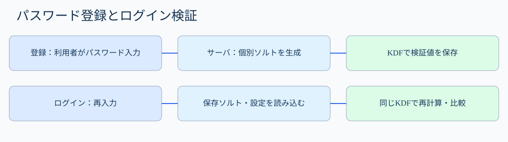
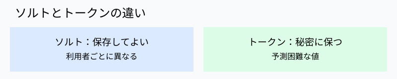
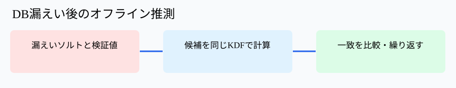

# 第41講｜乱数・ソルト・パスワードハッシュ

## 到達目標・参考書
パスワード保存の登録・照合手順、ソルトの役割と限界、ストレッチング・専用KDF、暗号学的乱数の必要性、漏えい後の攻撃と対策を科目A/Bで説明できること。
**参考書で確認した箇所**：『徹底攻略 情報処理安全確保支援士教科書 令和7年度版』第4章4-1「暗号化」p.269「ソルト」、第4章4-2「認証」p.291「パスワードの保管方法」。以下のArgon2id・PBKDF2・ログ・設計例は講師独自の補足。乱数一般の体系的な解説はこの2箇所から直接導いたものではない。
**優先順位**：A必須75％／B理解補助20％／C発展5％。

## 1. パスワードをそのまま保存すると何が起きるか【A】
Webサイトで会員登録した利用者Aがパスワード「sakura123」を設定したとする。サーバがDBのpassword列にそのまま「sakura123」と保存すると、DBが盗まれた瞬間に攻撃者はパスワードを読める。別サイトで同じパスワードを使っていれば、攻撃者が別サイトにもログインする「パスワードリスト攻撃」に利用できる。

そこでパスワードの**検証に必要な情報だけ**を保存する。ログイン時には入力されたパスワードを同じ方式で処理し、保存値と照合する。元のパスワードを復号して比較する設計ではない。

## 2. ハッシュだけでは十分でない【A】
ハッシュ関数は任意長の入力から固定長の値を計算する。通常、ハッシュ値から元のパスワードを直接逆算することは困難だが、**候補を試すこと**はできる。攻撃者は漏えいしたハッシュ値に対して「password」「123456」などをハッシュ化し、同じ値になる候補を探す。これが辞書攻撃である。

同じパスワードなら同じハッシュ値になる。多数の利用者のハッシュ値が同じなら、同じパスワードを使っていることも推測できる。事前計算したパスワード候補とハッシュ値の対応表を利用する攻撃（レインボーテーブルなど）にも弱い。

**重要**：SHA-256は安全な汎用ハッシュ関数であっても、単独でパスワード保存に適するわけではない。高速に大量計算できるため、漏えい後のオフライン推測攻撃に利用されやすい。

## 3. ソルトとは何か【A】
ソルト（salt）は、パスワードのハッシュ化に使う**利用者ごとのランダムな追加データ**である。秘密にする必要はなく、通常はハッシュ値とともに保存する。

たとえば利用者AとBが偶然同じ「sakura123」を使っていても、Aのソルトを「R7m...」、Bのソルトを「Q2x...」と別々に生成する。処理する入力が異なるため、保存される検証値も通常異なる。

これにより、(1)同じパスワードの利用者をハッシュ値の一致だけで判定しにくくする、(2)事前計算表を使い回しにくくする、(3)攻撃者に利用者ごとの推測計算を要求する、という効果がある。

**ソルトはパスワードを強くする魔法ではない。** DBと一緒にソルトも盗まれた場合、攻撃者はそのソルトを使って候補を試せる。弱いパスワードを選んだ利用者のリスクは残る。ソルトの使い回しや固定値は効果を損なう。



### 登録処理の順序
1. 利用者がパスワードをTLSで保護された通信で送信する。
2. サーバが**暗号学的に安全な乱数生成器（CSPRNG）**で利用者ごとに新しいソルトを生成する。
3. サーバがパスワード・ソルト・コスト設定を使ってパスワード用KDFを計算する。
4. DBにアルゴリズム識別子・コスト設定・ソルト・検証値を保存する。**平文パスワードは保存しない**。

### ログイン検証の順序
1. 利用者がパスワードを入力する。
2. サーバが該当利用者の保存済みソルト・方式・コスト設定をDBから読む。
3. 入力パスワードを同じ方式・設定で計算し、保存値と安全に比較する。
4. 一致すればパスワードの照合に成功する。ただし認証の全体にはMFAや試行制限なども関係する。

**なぜソルトを保存してよいのか？** ソルトの役割は秘密の鍵になることではなく、利用者ごとの計算を異ならせることだからである。

## 4. ストレッチングとパスワード専用KDF【A】
ソルトだけでは、攻撃者が一つのアカウントに対して毎秒大量の候補を試すことを防げない。そこで、パスワードの検証値を求める処理を意図的に重くする。

**ストレッチング**は計算を繰り返すなどしてパスワード推測に必要な計算量を増やす考え方。実装では、Argon2id、scrypt、bcrypt、PBKDF2などの**パスワード保存用の方式**を使い、適切なコストを設定する。Argon2idやscryptはメモリも消費させることで並列推測のコストを高める。

たとえば通常のログインでは1回の検証に少し時間がかかるだけだが、攻撃者が100万候補を試す場合は100万回分の負担になる。サーバの性能と負荷を考慮して設定する必要がある。

単にSHA-256を1回計算する方式や、独自にSHA-256を繰り返す方式より、十分検証された専用KDFを選ぶことが重要。パスワード保存用の**一方向の検証値**を作るものであり、元のパスワードを復号するための暗号化とは異なる。

## 5. 乱数の安全性と使い分け【A/B】
乱数は「毎回違う値」であるだけでは不十分。攻撃者が次の値を予測できると、認証トークンやセッションIDを推測してなりすましに使える。

**CSPRNG**は暗号学的に安全な疑似乱数生成器で、内部状態を知らない攻撃者が出力を予測しにくいよう設計される。OSが提供する暗号用乱数APIを利用し、時刻や連番、一般用途の予測可能な乱数生成器をセキュリティ用途に使わない。

用途によって要件が異なる。ソルトは**一意性・予測困難な生成方法**が重要で、秘密にする必要はない。セッションID・認証トークンは**推測困難性と秘密保持**が必要。暗号鍵には十分なエントロピー（不確実性）が必要。



**エントロピー**とは攻撃者にとっての予測の難しさを表す概念。単に文字列が長いだけでは高エントロピーとは限らない。例えば「202611040800」のような時刻由来の長い値は候補が絞れる。

## 6. 具体的な攻撃と防御【A】
### DB漏えい後のオフライン攻撃
攻撃者はユーザーID、ソルト、保存検証値を持ち出す。候補パスワードを一つ選び、盗んだソルトと設定で同じKDFを計算する。一致するか比較し、外れたら次の候補を試す。これはログイン画面にアクセスせずに進むため、**ログイン試行回数制限だけでは止められない**。

対策は、利用者ごとに独立したランダムソルト、適切なコストの専用KDF、強いパスワード、漏えい時のパスワードリセットや監視である。MFAは漏えいしたパスワードを使う不正ログインの被害を減らせるが、ハッシュ値の解析そのものを止めるものではない。

### オンラインのパスワード推測
攻撃者がログイン画面に候補を送信し続ける。ここではレート制限、遅延、アカウント保護、MFA、異常検知が有効。ただし過度なアカウントロックはサービス妨害にも悪用されるため設計が必要。

### 予測可能なトークン
セッションIDを現在時刻と連番から生成すると、攻撃者が他人のIDを推測して送信できる可能性がある。CSPRNGによる十分長いランダム値と安全な保存・送信が必要。



## 7. 設定・ログを読む【A】
以下は講師作成の**擬似的な設定・ログ例**。特定製品の実仕様ではない。

```text
user=alice password_scheme=argon2id salt=unique cost=approved verify=success
user=bob   password_scheme=sha256  salt=none   verify=success
event=db_export_detected records=120000
event=login_failed user=alice attempts_1m=35 source_ip=198.51.100.23
```

aliceは専用KDFと個別ソルトを利用している。一方bobの単純SHA-256・ソルトなしは、DB漏えい時のオフライン攻撃に弱い。DBエクスポートの検知があっても、パスワードがすべて直ちに判明したとは断定できない。大量のログイン失敗はオンライン推測の疑いがあるが、オフライン攻撃とは区別する。

**注意**：実ログにパスワード、秘密鍵、認証トークンを出力してはいけない。ソルトは秘密ではないが、不要な認証関連情報のログ出力は抑える。

## 8. 科目A・科目Bの解答ポイント【A】
**科目A**：ソルトは利用者ごとに異なる値で、ハッシュ値の使い回し・事前計算攻撃を難しくする。秘密にする必要はない。ストレッチング・専用KDFは候補を試す計算コストを上げる。レート制限はオンライン攻撃向けであり、DB漏えい後のオフライン攻撃を直接止めない。

**科目B例題1**：パスワードDBが漏えいした。保存値はSHA-256(password)で、ソルトなし。どのように危険で、どう改善するか。
**判断過程**：攻撃者は漏えいしたハッシュ値と候補パスワードを比較できる。高速なSHA-256単独では多数候補を試せる。同一パスワードの同一ハッシュ値や事前計算表も利用され得る。
**答案例**：「攻撃者は候補パスワードのSHA-256値を計算して漏えいハッシュ値と照合し、パスワードを推測できる。利用者ごとにランダムソルトを生成し、Argon2id等の適切なコスト設定のパスワード用KDFで保存する。」

**科目B例題2**：セッションIDが時刻と連番から生成される。
**判断過程**：時刻・連番は攻撃者に推測可能であり、他人のIDを予測できる場合がある。予測したIDが有効ならなりすましが可能。
**答案例**：「攻撃者が生成規則から他利用者のセッションIDを推測し、なりすましてアクセスできる。OSの暗号学的に安全な乱数生成器で十分な長さの予測困難なIDを生成する。」

## 9. 最終整理と発展【A/B/C】
| 用語 | 主目的 | 秘密か | 注意点 |
|---|---|---|---|
| パスワード | 本人だけが知る認証情報 | 秘密 | 使い回し・弱い文字列に注意 |
| ソルト | 利用者ごとの検証値を異ならせる | 秘密でない | 固定・共通ソルトを避ける |
| ペッパー | 別管理の秘密値を加える追加防御 | 秘密 | DB外の鍵管理が必要 |
| パスワード用KDF | オフライン推測の計算コストを上げる | 方式は公開 | Argon2id等と適切な設定 |
| CSPRNG | 予測困難な乱数を生成 | 出力の秘密性は用途次第 | 時刻・連番で代用しない |
| レート制限 | オンライン試行の抑制 | — | オフライン推測には無効 |

**B理解補助**：ソルトは通常保存値とともに保持し、ログイン時に再利用する。ペッパーはDBとは別管理の秘密値で、ソルトとは役割が異なる。
**C発展・任意**：Argon2idのメモリ・並列度パラメータ調整、パスワードハッシュの段階的移行、ペッパーのローテーションとHSM管理。

## 10. 理解度チェック
選択式6問（各1点）・記述式3問（各3点）、合計15点。回答前に正解は提示しない。
