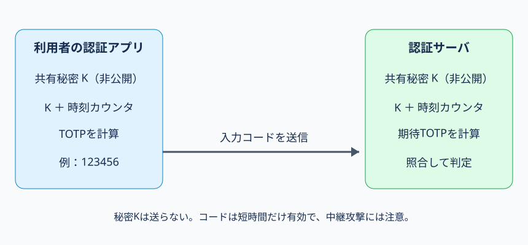

# 第46講｜ワンタイムパスワード

## 到達目標・根拠・学習優先度
**到達目標**：ワンタイムパスワード（OTP）が固定パスワードの再利用リスクを減らす理由、TOTP・HOTP・SMS・S/Keyの違い、共有秘密の登録と検証、攻撃と対策、ログの解釈を科目A/Bで説明できる。

**参考書**：『徹底攻略 情報処理安全確保支援士教科書 令和7年度版』第4章4-2「認証」、印刷p.287（認証デバイスの時刻同期OTP）、p.290–291（パスワード認証、OTP、セキュリティトークン、S/Key）。実際にPDFの該当箇所を確認。以下のHOTP/TOTPの内部処理、SMSの脅威、ログ、科目B答案例は**講師独自の補足**。参考書の「ネットワーク上を流れるパスワードを毎回変える」という説明はOTPの狙いを示すが、OTPがすべての攻撃を防ぐという意味ではない。

**優先度**：A必須75%、B理解補助20%、C発展5%。

## 1. 固定パスワードの何が問題なのか【A】
Aさんが毎回同じパスワード `River-Example-2026` を送るシステムを考える。攻撃者が一度その値を盗めば、変更されない限り再び入力してログインできる可能性がある。そこで、**認証のたび、または短い時間ごとに値が変わるコード**を使うのがOTP（One-Time Password）である。

OTPが狙うのは、盗まれた**古い認証コードの再使用（リプレイ）**を難しくすること。ただし「一度だけ」と名付けられていても、実装によっては有効時間内の同じコードを複数回受理してしまう。**期限と使用済み管理の両方**が重要である。

OTPを固定パスワードに追加する場合は二要素認証の一部となり得るが、OTPだけで必ず二要素になるわけではない。OTPを生成・受信する手段と本人確認の設計を確認する。

## 2. TOTPの登場人物と初期登録【A】
**TOTP（Time-based One-Time Password）**は時刻同期型OTPである。Aさんの認証アプリと認証サーバSが、同じ秘密値Kと現在時刻を使ってコードを計算する。

登録時：(1) Sが暗号学的に安全な乱数から利用者専用の秘密Kを生成する。(2) SはKを安全に保存し、Aの認証アプリへQRコードなどで**安全な登録経路**を通じて渡す。(3) アプリはKを保存する。(4) Aが生成されたコードを入力し、Sが一致を確認して登録を確定する。QRコードは単なる表示画像ではなく、秘密Kを含むことがあるため、第三者に見せたり公開したりしてはいけない。

ここで秘密なのは**K**。利用者ID、現在時刻、コード生成方式などは原則秘密にしない。サーバは利用者のスマートフォンに問い合わせずとも、同じKと時刻から期待コードを自分で計算できる。これがオフラインでも認証アプリにコードを表示できる理由である。



**図の読み方**：左と右が登録済みの同じ秘密Kを保管する。双方が同じ時間区間を用いてコードを計算する。中央の矢印で送るのは表示された短いコードであり、秘密Kではない。

## 3. TOTPのログイン処理と時間ずれ【A】
通常のパスワード＋TOTPでは、(1) AがIDとパスワードを正規サイトへ送る。(2) Sがパスワードを検証する。(3) Aが認証アプリのTOTPを入力する。(4) Sが保存済みKと時刻から期待コードを生成し照合する。(5) 必要な他の条件も満たせばログインを許可し、セッションを発行する。

たとえば30秒ごとに時刻区間を切り替える設計なら、09:00:00–09:00:29と09:00:30–09:00:59では通常異なるコードになる。これは説明用の例であり、実装によって間隔や桁数は異なる。

**なぜ時計を合わせる必要があるか**：端末が09:00の区間だと思っているのにサーバが09:01の区間だと、同じKでも入力が一致しない。時刻ずれを考慮して前後の時間区間のコードも受け付ける設計がある。ただし許容範囲を広げると攻撃者がコードを使える時間も長くなる。正しい時刻同期、短い許容窓、使用済みコードの再利用防止、失敗回数制限を組み合わせる。

**重要な区別**：TOTPはパスワードを暗号化して送る仕組みではない。共有秘密Kから短時間だけ有効な**別のコードを生成する**仕組みである。通信の盗聴・改ざんには引き続きTLSが必要。

## 4. HOTPとの違い【A/B】
**HOTP（HMAC-based One-Time Password）**は、秘密Kと増加するカウンタCからOTPを生成する方式。HMACとは、秘密鍵を使ってメッセージの完全性・認証に用いる値を作る仕組みである。

TOTPは時間を入力にするため、基本的に時間区間が進むとコードが変わる。HOTPはカウンタを入力にするため、ボタン操作などでカウンタが進むとコードが変わる。両者は関連するが同じものではない。

| 比較 | TOTP | HOTP |
|---|---|---|
| 変化の基準 | 時刻の区間 | カウンタ値 |
| 共有する秘密 | K | K |
| 同期上の課題 | 端末とサーバの時刻ずれ | カウンタのずれ |
| 主な対応 | 時刻同期・許容窓 | カウンタの同期・再同期 |

**なぜカウンタがずれるか**：利用者が端末でコードを何回も生成したのにサーバへ送らなければ、端末側だけCが進むことがある。サーバは一定範囲を探索して同期し直す場合があるが、広すぎる探索窓は安全性に影響する。

## 5. SMSコードとS/Key【A/B】
**SMSコード**：サーバが生成した短いコードを登録電話番号へ送信し、入力された値と照合する。TOTPと違い、利用者アプリとサーバが同じKからコードを計算する方式とは限らない。SIMスワップ（電話番号を攻撃者が支配する手続）、SMS転送、盗み見、偽サイトへの入力に注意する。電話番号の変更・再登録時の本人確認も重要。

**S/Key**：参考書p.291で紹介される、種（Seed）とハッシュ関数を使ったハッシュ連鎖型OTP。たとえば種にハッシュ関数を繰り返し適用して系列を作り、認証のたびに順序に沿った値を使用する。サーバはハッシュ演算で次の値を検証できる。TOTPのように時刻を基準にする方式ではない。科目Aでは**S/Key＝ハッシュ連鎖、TOTP＝時刻同期、HOTP＝カウンタ同期**を区別できればよい。

## 6. OTPを狙う攻撃と防御策【A】
**①リプレイ攻撃**：攻撃者が過去に観測したOTPを再送する。コードを期限切れ・使用済みとして拒否すれば防ぎやすい。しかし同じ時間窓のコードを何度でも許可する実装では再利用の余地がある。

**②リアルタイム・フィッシング中継**：攻撃者Eが偽サイトを用意し、Aが入力したパスワードと現在有効なOTPを即座に正規サイトへ転送する。正規サイトには「有効な値」が届くため、OTPの有効期限が短いだけでは防げない。**FIDO2/WebAuthnなど、認証応答を正規サイトのオリジンに結び付ける方式**が対策候補となる。

**③OTPの総当たり**：短い数字コードには候補数の限界がある。たとえば6桁なら理論上100万通りだが、試行回数制限なしに短時間で大量送信できる設計は危険。アカウント・送信元・時間帯を考慮したレート制御、監視、短い有効期限を組み合わせる。

**④共有秘密Kの漏えい**：攻撃者が登録用QRコードや認証アプリの秘密Kを取得すると、自分の端末で将来のTOTPを生成できる可能性がある。コードの短命性では防げない。Kの保護、認証器の再登録・無効化、利用者への通知が必要。

**⑤復旧手続の悪用**：OTP認証器を紛失したと偽ってヘルプデスクに解除させる。登録・変更・解除・復旧時の本人確認、承認、記録、通知を強化する。

## 7. ログを使って攻撃と障害を区別する【A】
講師独自の架空ログ：

```text
09:00:01 user=a01 password=OK otp=FAIL reason=TIME_WINDOW
09:00:31 user=a01 password=OK otp=SUCCESS src=203.0.113.8
09:00:34 user=a01 password=OK otp=FAIL reason=REUSED_CODE
09:01:02 user=a01 factor=RESET actor=helpdesk
```

**確実な事実**：最初のOTPは時刻窓の条件で拒否され、次は成功、さらに再利用コードが拒否され、その後ヘルプデスクによる認証器リセットが記録されている。**断定できないこと**：最初の失敗が本当に端末時計のずれによるか、同一人物が操作したか、リセットが本人の依頼だったか。**調査**：時刻同期状況、送信元・端末、成功セッションの操作、リセット受付と本人確認・承認履歴。**対策**：時刻同期の維持、再利用拒否、試行制限、復旧時の本人確認・監査。

## 8. 科目Aと科目Bの答案【A】
科目A：①TOTPとHOTPの変化基準、②S/Keyのハッシュ連鎖、③SMSと認証アプリの生成主体、④OTPがリプレイを抑えてもリアルタイム中継を防がない理由、⑤登録秘密・再利用・復旧手続を区別する。

科目Bの例：「TOTPを導入したが、利用者が偽サイトに入力したコードを攻撃者がすぐ正規サイトに送信し、不正ログインされた。原因と対策を述べよ。」

**答案を組み立てる順序**：(1) 利用者は偽サイトに有効なコードを入力した。(2) 攻撃者は期限内に正規サイトへ中継した。(3) TOTPの値は正規サイトのドメインに暗号学的に結び付いていない。(4) 期限短縮だけでは十分でない。(5) 正規サイトへの結び付きを持つFIDO2/WebAuthnを導入する。

**答案例**：「TOTPは有効時間内のコードを偽サイトから正規サイトへ中継でき、コードが正規サイトのオリジンに結び付いていないため。FIDO2/WebAuthnなどのフィッシング耐性のある認証方式へ変更する。」

## 9. 重要事項と発展【A/B/C】
**A必須**：TOTPは共有秘密K＋時刻、HOTPはK＋カウンタ、SMSはサーバから送信するコード、S/Keyはハッシュ連鎖。OTPの狙いは古いコードの再使用防止。リアルタイム中継、秘密Kの漏えい、解除・復旧の弱点には別の対策が必要。

**B理解補助**：時刻許容窓、使用済みコード管理、HOTPカウンタ同期、OTPの試行回数制限。

**C任意**：RFC 4226/6238の内部演算・動的切出し処理、具体的なカウンタ探索幅やTOTPの時間間隔の調整。

## 10. 理解度チェック
選択式6問（各1点）＋記述式3問（各3点）＝15点。正解は回答後に提示する。
