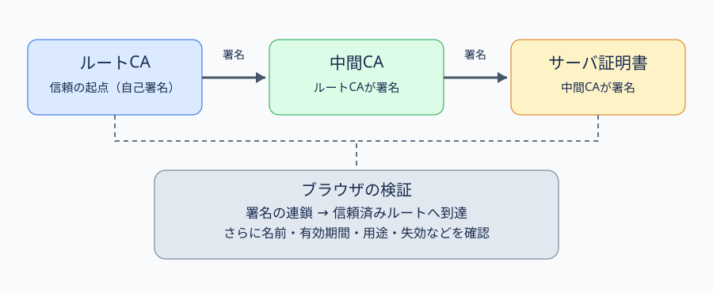

# 第48講｜PKI

## 到達目標・出典と優先度
**到達目標**：公開鍵の「所有者」をどう信頼するか、CA・RA・IA・ルートCA・中間CA・証明書の役割、証明書チェーン、失効、TLS接続時の検証失敗の原因と対策を、科目A/Bで判断できる。

**参考書確認済み**：『徹底攻略 情報処理安全確保支援士教科書 令和7年度版』第4章4-2-2「PKI」印刷p.275–279。CA・RA・IA、証明書、CRL、VA、OCSP、DV/OV/EV、プライベートCAは参考書に基づく。ルート・中間CAの詳細な連鎖、TLSの名前・用途検証、架空ログ、攻撃・対策の説明は**講師独自の補足**。参考書p.278–279のEV証明書とブラウザの緑色表示に関する説明は、現在の主要ブラウザの表示と一致しないため、緑色表示を現在の必須条件とはしない。

**学習優先度**：A必須75%、B理解補助20%、C発展5%。

## 1. PKIは何の問題を解決するのか【A】
前に学んだ公開鍵暗号では、秘密鍵は所有者だけが持ち、公開鍵は他人に渡してよい。しかし「受け取った公開鍵が、本当に通信相手のものか」という問題が残る。

たとえばAさんが銀行 `bank.example` の公開鍵を取得したつもりでも、攻撃者Eが途中で自分の公開鍵に差し替えたら、AさんはEに向けて秘密情報を暗号化してしまう可能性がある。**公開鍵の計算上の安全性と、公開鍵の持ち主が正しいことは別問題**である。

**PKI（Public Key Infrastructure、公開鍵基盤）**は、信頼できる認証局（CA）が「この公開鍵は、この名前の主体に結び付いている」と電子署名した**公開鍵証明書**を発行し、その関係を第三者が検証できるようにする仕組みである。公開鍵自体は秘密ではない。保護すべきものは主に秘密鍵と、証明書発行・検証の手続である。

## 2. CA・RA・IAの役割と証明書発行【A】
**CA（Certificate Authority、認証局）**：証明書を発行する信頼の主体。**RA（Registration Authority、登録局）**：申請受付と本人・組織・ドメインなどの確認を担う。**IA（Issuing Authority、発行局）**：CAの運用の中で実際の証明書発行と署名を担う役割。組織によって物理的に別システムとは限らない。

架空の会社XがWebサーバ証明書を取得する流れ：
1. Xの管理者がサーバ用の**公開鍵と秘密鍵のペア**を作り、秘密鍵は自社で安全に保持する。
2. 公開鍵、対象ドメイン名などを含む**CSR（Certificate Signing Request、証明書署名要求）**を作ってCAに申請する。CSRは発行要求であり、発行済み証明書そのものではない。
3. RA相当の審査で申請者が対象ドメインを管理できることなどを確認する。証明書の種類によって確認範囲が違う。
4. IAが証明書の内容にCA側の秘密鍵で**電子署名**し、証明書を発行する。
5. XはWebサーバに証明書と対応する秘密鍵を設定する。**サーバ秘密鍵をCAに渡す必要は通常ない**。
6. ブラウザは接続時に証明書を受け取り、発行元の署名と用途・名前などを検証する。

CAの署名は「証明書に記された公開鍵と名前の対応を、CAが定めた確認手続で認めた」という意味。証明書の署名は**Webサイトの内容が安全であること**や**運営者が善良であること**を保証しない。

## 3. X.509証明書に何が書かれるか【A】
公開鍵証明書の代表的規格は**X.509**。主な情報は、主体（Subject）、発行者（Issuer）、公開鍵、有効期間（Not Before / Not After）、シリアル番号、署名アルゴリズム、CAの電子署名など。

Webサイトの名前確認では**SAN（Subject Alternative Name、サブジェクト代替名）**に記載されたDNS名が重要。たとえば証明書に `www.example.test` のみが登録されていれば、通常 `login.example.test` への接続では名前不一致になる。公開鍵が正しく署名されていても、**接続先の名前が一致しなければ受け入れてはいけない**。

さらに**Key Usage / Extended Key Usage**などの用途制限、CAとしての利用を示すBasic Constraintsなどがある。サーバ証明書を中間CAのように使えるわけではない。

## 4. 信頼の連鎖（証明書チェーン）【A】
実際のWeb PKIでは、多くの場合「サーバ証明書←中間CA←ルートCA」という階層を使う。



**ルートCA（Root CA）**は信頼の起点。自己署名証明書を持つが、**自己署名だから自動的に信頼されるのではない**。OSやブラウザの信頼ストアに信頼済みとして登録されているから信頼できる。**中間CA（Intermediate CA）**は上位CAに署名された証明書を持ち、サーバ証明書を発行する。

ブラウザは、①サーバ証明書の署名を中間CAの公開鍵で検証、②中間CA証明書の署名を上位CAの公開鍵で検証、③信頼済みルートまでたどれるか確認する。さらに④接続先ホスト名、⑤有効期間、⑥証明書の用途・CA制約、⑦必要な失効状態を確認する。**署名が正しいだけでは十分でない**。

中間CA証明書がサーバから送られず、クライアント側でも補完できない場合、正しいサーバ証明書でもチェーンを構築できず検証失敗になることがある。対策は不足する中間CA証明書を正しくサーバへ設定すること。**証明書検証を無効にすることではない**。

## 5. CRLとOCSP：期限内でも失効する【A】
証明書には有効期限がある。しかし期限内でも秘密鍵の漏えい、誤発行、運用停止などがあれば、**失効（revocation）**させる必要がある。

**CRL（Certificate Revocation List、証明書失効リスト）**はCAが発行する失効済み証明書の一覧。検証者は署名されたCRLを取得し、対象のシリアル番号が掲載されていないかを調べる。CRLは一定間隔で更新されるため、更新の遅れや配布不能を考慮する。

**OCSP（Online Certificate Status Protocol）**は対象証明書の状態を問い合わせる方式。レスポンダは典型的に `good`、`revoked`、`unknown` に対応する応答を返す。**goodは「この証明書が現在の失効情報上は失効とされていない」という趣旨であり、名前・用途・発行元の検証を省略してよいという意味ではない**。

失効確認サービスに到達できないときに接続を続ける**soft-fail**と、失敗扱いにする**hard-fail**では、可用性と安全性のトレードオフがある。失効確認の実際の動作はブラウザ・OS・証明書の種類・ポリシーにより異なり、すべてのWeb接続で必ずリアルタイムOCSP照会が行われるわけではない。

**VA（Validation Authority、検証局）**は参考書p.278で、証明書の有効性確認を専門に行う役割として紹介されている。CAの発行業務とは区別する。

## 6. DV・OV・EVとプライベートCA【A/B】
**DV（Domain Validation）**：ドメインの管理権限を確認する。組織の実在性まで保証しない。**OV（Organization Validation）**：ドメインに加え組織の実在性などを確認する。**EV（Extended Validation）**：より厳格な組織審査を伴う。

**重要な現行仕様との差**：参考書p.278–279にはEV証明書をブラウザの緑色アドレスバーなどで区別する説明があるが、現在の主要ブラウザでは一般にそのような常時表示は行われない。**EVだから暗号が強い、DVだから通信が暗号化されない、ということでもない**。いずれも適切なTLS設定と証明書検証が必要。

**プライベートCA**：組織が自ら管理するCA。社内端末にはそのルートCAを信頼ストアへ配布して利用できる。一方、社外の一般ブラウザには通常そのルートが登録されていないため、検証に失敗する。**ブラウザ警告を無視するのでなく、適切な信頼ストア管理と配布を行う**。

## 7. 攻撃・障害をログから区別する【A】
以下は講師独自の架空ログ。

```text
10:00 host=api.example.test tls=FAIL reason=NAME_MISMATCH
10:03 host=api.example.test tls=FAIL reason=UNKNOWN_ISSUER
10:07 host=api.example.test tls=FAIL reason=CERT_EXPIRED
10:10 host=api.example.test tls=FAIL reason=REVOKED
```

**NAME_MISMATCH**：接続先名と証明書のSAN等が一致しない。対象ホスト名を含む適切な証明書を設定する。**UNKNOWN_ISSUER**：信頼できるルートまで連鎖を構築できない。中間証明書の不足、信頼ストア、誤ったCAの発行などを調査する。**CERT_EXPIRED**：有効期間を過ぎている。正しい新証明書へ更新する。**REVOKED**：失効状態が確認された。秘密鍵漏えい等の原因を調べ、鍵ペア・証明書を再発行し、旧証明書を使わない。

注意：このログだけでは、各エラーが**攻撃によるものか設定ミスか**は断定できない。証明書のSubject/SAN、Issuer、シリアル番号、有効期間、チェーン、信頼ストア、配布・更新履歴、CAの失効情報を追加確認する。

## 8. 科目Aと科目Bの判断【A】
科目Aで区別するもの：**公開鍵暗号化とCAによる署名**、CAとRAとIA、ルートCAと中間CA、署名検証と名前検証、CRLとOCSP、DVとOVとEV。

科目Bケース：「社内Webサーバの証明書を更新した直後、一部の端末だけ `UNKNOWN_ISSUER` で接続失敗。サーバは中間CA証明書を送っていなかった。原因と対策を述べよ。」

**考え方**：観測事実は一部端末の信頼連鎖検証失敗。端末によっては中間CA証明書がキャッシュされ、別の端末では不足している可能性がある。原因はサーバが必要な中間証明書を送らず、クライアントが信頼済みルートまで連鎖を構築できないこと。対策は正しい中間CA証明書をサーバへ設定し、複数環境でチェーン検証すること。

**答案例**：「サーバが中間CA証明書を送信しておらず、一部端末で信頼済みルートCAまで証明書チェーンを構築できないため。正しい中間CA証明書をサーバに設定して送信させる。」

**別のケース**：「署名は正しいが接続先のDNS名とSANが異なる」なら、対策は名前が一致する証明書への更新。ルートCAを追加しても名前不一致は解消しない。

## 9. まとめと発展
**A必須**：PKIは公開鍵と主体の結び付きを検証する基盤。CAが署名し、クライアントはチェーン・名前・期間・用途・失効を確認する。秘密鍵漏えい時は失効と鍵更新。検証エラーを安易に無効化しない。

**B理解補助**：RA/IA/VAの役割、DV/OV/EV、プライベートCA、失効確認不能時のポリシー。

**C発展・任意**：証明書ポリシーOID、名前制約、クロス署名、証明書透明性（CT）、ACME自動更新の実装詳細。

## 10. 理解度チェック
第47講以降の標準方式：**基礎5問×1点、応用3問×2点、科目B型2問×2点、全10問15点**。解答前に正解は公開しない。
