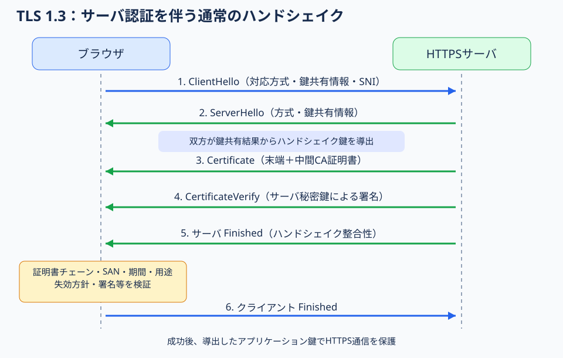

# 第51講｜TLS証明書検証

## 1. 到達目標と根拠資料【A】
**到達目標**：HTTPS接続でクライアントがサーバ証明書を検証する理由と順序を説明し、信頼連鎖・署名・接続先名・有効期間・用途・失効・秘密鍵所持を切り分ける。証明書エラーとログから、原因・影響・対策を科目B形式で記述できる。

**参考書の確認箇所**：『徹底攻略 情報処理安全確保支援士教科書 令和7年度版』第4章4-2-2「PKI」印刷p.276〜279（証明書の作成と検証、CRL、OCSP、エラー）、第6章6-1-1「TLS」印刷p.378〜380（ハンドシェイクとサーバ認証）。実際のPDF本文を確認した。**注意**：参考書p.378〜379のハンドシェイク図は従来方式のメッセージ構成で、TLS 1.3のメッセージ順序をそのまま表すものではない。以下のTLS 1.3のCertificateVerify・Finished、SANの扱い、現代的な検証の切り分けは講師独自の技術補足。IPAの特定過去問との照合は未実施。

**学習優先度**：A必須75%、B理解補助20%、C発展5%。証明書発行の説明は第49・50講で学んだものとして簡潔に再確認し、本講では「ブラウザが何を、どの順に、何のために検証するか」を中心にする。

## 2. そもそもHTTPSの鍵マークは何を保証するのか【A】
あなたが `https://pay.example.test/` を開くと、ブラウザはサーバとTLS通信を始める。しかし暗号化だけでは「通信相手が本物か」を保証できない。攻撃者の偽サーバとの間で暗号化が成立しても、その相手に情報を渡してしまえば被害が生じる。だからTLSでは**鍵共有とサーバ認証**を組み合わせる。

サーバ証明書には公開鍵、対象の名前、発行者、有効期間、用途などが含まれ、CAが証明書の内容に署名している。サーバは秘密鍵を保持する。ブラウザは「証明書が改ざんされていないか」「信頼するCAまでつながるか」「接続先名と一致するか」「今使えるか」「相手が秘密鍵を持つか」を確かめる。

ただし、HTTPSが正常でも**Webサイトの内容が詐欺ではないこと**、**サーバがマルウェアに感染していないこと**、**利用者の操作が正当であること**までは保証しない。試験では「通信相手の認証・通信の保護」と「サイトの事業者の善意」を混同しない。

## 3. 証明書チェーンと信頼の起点【A】
たとえばブラウザが次の3段階を検証する。

| 階層 | 証明書 | 誰が署名したか | 役割 |
|---|---|---|---|
| 末端（leaf） | `pay.example.test` | 中間CA | サーバ名と公開鍵を結び付ける |
| 中間CA | Example Intermediate CA | ルートCA | サーバ証明書の発行元 |
| ルートCA | Example Root CA | 通常は自己署名 | 信頼の起点（トラストアンカー） |

ブラウザは末端証明書の署名を中間CAの**公開鍵**で検証し、中間CAの署名を上位CAの公開鍵で検証する。さらに中間CAがCAとして署名できるか（Basic Constraints、Key Usage等）も確認する。最終的に、信頼ストアに登録済みの**信頼できるルートCA**へつながるかを確かめる。**単にルートが自己署名されているだけでは信頼できない**。そのルートを信頼する設定が必要だからである。

サーバは通常、末端証明書と必要な中間CA証明書を提示する。ルートCA証明書はクライアントの信頼ストア側にあるのが一般的。中間証明書が欠けると、クライアントが別途入手できない場合は`INCOMPLETE_CHAIN`等のエラーになる。対策は適切な中間証明書をサーバに設定することで、**検証を無効化することではない**。

### 「CA署名が正しい」だけでは不十分
署名が正しくても、攻撃者が`attacker.example.test`用に正規発行された証明書を`pay.example.test`で見せれば、**接続先名が違う**。また、期限切れや失効、用途不一致も起こり得る。検証は複数条件のAND（すべて満たす）で考える。

## 4. SAN・有効期間・用途・失効の検証【A】
**SAN（Subject Alternative Name）**は証明書が対象とするDNS名やIPアドレス等を示す拡張領域。接続先が`pay.example.test`なら、SANにその名前が含まれるかを照合する。現代のHTTPSではCN（Common Name）だけを見て合格と判断しない。

`DNS:*.example.test`のようなワイルドカードは、一般に`shop.example.test`のような一階層の名前には一致するが、`a.shop.example.test`や`example.test`には一致しない。DNSの名前解決が正しくても、証明書のSAN一致は別に必要である。

**有効期間**：`notBefore`から`notAfter`までの期間に現在時刻が入るかを確認する。端末の時計が誤っていると、実際には有効な証明書でも検証に失敗し得る。ただし時計を無条件に戻すのではなく、時刻同期を調査する。

**用途**：サーバ証明書にはTLSサーバ認証に適したExtended Key Usage（EKU）やKey Usage等が必要となる。クライアント認証専用の証明書をサーバ用途に転用しない。CA証明書はCAとしての制約を満たす必要がある。

**失効**：証明書の秘密鍵漏えい等で、期限前に失効することがある。CRLまたはOCSP等による失効確認の扱いはクライアントの実装・設定による。OCSPの`good`は名前・署名・用途の正当性を丸ごと保証するわけではない。失効情報が取得できないときはsoft-fail/hard-fail等のポリシーを確認する。

| 検証項目 | 典型的な失敗 | 対策の方向 |
|---|---|---|
| 信頼連鎖 | 未信頼ルート・中間CA欠落 | 信頼ストア・正しい中間証明書の確認 |
| 名前 | SANに接続先がない | 接続先名を含む証明書を正しく発行・設定 |
| 時間 | 期限切れ・開始前・端末時刻誤り | 更新と時刻同期の確認 |
| 用途 | EKU等が不適切 | サーバ認証用の証明書を利用 |
| 失効 | revoked、応答不能 | 失効状態・配布経路・ポリシーを確認 |
| 鍵の所持 | 証明書に対応する秘密鍵を持たない | 正しい鍵ペアと証明書の組合せを設定 |

## 5. TLS 1.3のハンドシェイクで実際に何を確かめるか【A】
**TLS 1.3の通常の証明書認証を伴うフルハンドシェイク**を例にする。参考書の古いTLS図のメッセージをそのまま当てはめず、以下のように区別する。図は通常のサーバ認証の概念図であり、再開接続・PSK認証・クライアント証明書認証等の全分岐を示していない。



1. **ClientHello**：ブラウザは対応TLSバージョン・暗号スイート・鍵共有に必要な情報などを送る。SNI（Server Name Indication）を使う場合、接続したいサーバ名も伝える。SNIはサーバが適切な証明書を選ぶ手掛かりだが、**SNIを送っただけで証明書の名前検証が終わるわけではない**。
2. **ServerHello**：サーバが選んだ方式や鍵共有情報を返す。双方は鍵共有の結果からハンドシェイク通信を保護する鍵を導出する。鍵共有とサーバの身元確認は別の性質であり、鍵共有が成功しただけでは相手が本物とは分からない。
3. **Certificate**：サーバが末端証明書と必要な中間CA証明書を送る。TLS 1.3の通常の流れではこのメッセージはハンドシェイク鍵で暗号化される。**証明書の公開鍵は秘密ではない**。
4. **CertificateVerify**：サーバは証明書の公開鍵に対応する**秘密鍵**で、所定のハンドシェイク文脈に署名する。ブラウザは証明書内の公開鍵で署名を検証する。これによって、単に証明書のコピーを持っているだけではなく、**対応する秘密鍵を所持していること**を確かめる。秘密鍵そのものは送らない。
5. **Finished**：双方はハンドシェイクから導出した鍵を使い、やり取りの整合性を検証する。CertificateVerifyは「証明書の鍵に対応する秘密鍵を持つ」こと、Finishedは「鍵共有を含むハンドシェイクの整合性」を確認する役割であり、同一ではない。
6. **検証が成功した後のアプリケーション通信**：ブラウザは証明書チェーン・SAN・期間・用途・失効ポリシー等と、署名・ハンドシェイクの検証を踏まえてHTTPS通信を受け入れる。アプリケーションデータは導出した共通鍵で保護する。

**重要な因果関係**：攻撃者が正規サーバの証明書ファイルだけを盗んでも、秘密鍵がなければ通常のCertificateVerifyを正しく生成できない。一方、秘密鍵まで漏えいすればなりすましの危険が生じるため、証明書失効と鍵ペア交換が必要になる。

### TLS 1.2との区別【B】
参考書p.378〜379の図は`Server Key Exchange`、`Server Hello Done`、`Client Key Exchange`等を含む**従来方式の流れ**で、TLS 1.3と同じメッセージ名・順序ではない。また、TLS 1.2の鍵交換方式によって秘密鍵所持の確認方法は異なる。**TLS 1.3のサーバCertificateVerifyをTLS 1.2の全接続にそのまま一般化しない**。試験では設問が指定するTLSバージョンと鍵交換方式を先に確認する。

## 6. 障害・攻撃の具体例と切り分け【A】
### 例1：名前が違う
利用者は`https://pay.example.test`に接続したが、提示された証明書のSANは`DNS:shop.example.test`のみ。署名・有効期間が正しくても**名前不一致**で拒否すべき。対策は`pay.example.test`を含む正しい証明書を設定すること。**DNSのAレコード修正だけで必ず直るとは限らない**。

### 例2：中間CA証明書を設定し忘れた
サーバが末端証明書だけを提示し、ブラウザが発行元の中間CA証明書を入手できない。署名の連鎖を信頼済みルートまで構成できず失敗する。サーバに正しい中間CA証明書を含むチェーンを設定する。ルートCAを無条件に信頼ストアへ追加するのは危険。

### 例3：秘密鍵と証明書が対応していない
更新作業で新しい証明書と古い秘密鍵を組み合わせた。TLSハンドシェイクで署名を作れない、または検証に失敗する。証明書の公開鍵と秘密鍵が対応するかを確認する。**証明書が壊れているとは限らない**。

### 例4：攻撃者が検証を無効化させる
攻撃者が通信を妨害して証明書エラーを誘発し、「接続するには証明書検証をオフにして」と誘導する。検証を無効化すると、攻撃者の証明書や偽サーバを受け入れる危険がある。正しい対策はエラーの原因を特定し、信頼連鎖・名前・期間・鍵・失効の問題を修復すること。

## 7. 設定・ログの読み方【A】
以下は**架空の診断ログ**。実際の製品ではメッセージ名や発生順序が異なる。

```text
09:00 target=pay.example.test
09:00 leaf.subject=CN=pay.example.test
09:00 leaf.SAN=DNS:shop.example.test
09:00 issuer=Example Intermediate CA
09:00 chain=VALID
09:00 time=VALID
09:00 hostname=FAIL
09:00 handshake=ABORT
```

**事実**：チェーンと期間は検証に通ったが、SANが接続先名と異なり、ホスト名検証が失敗した。**原因**：`pay.example.test`を対象としない証明書が提示された。**影響**：本来のサーバと確認できないため、接続を継続すると偽サーバへの情報送信につながる危険がある。**対策**：接続先名をSANに含む証明書を取得し、正しい仮想ホスト・SNI設定で提示する。

別のログ：
```text
10:10 target=pay.example.test
10:10 leaf.SAN=DNS:pay.example.test
10:10 chain=FAIL reason=MISSING_INTERMEDIATE
10:10 hostname=VALID
10:10 revocation=NOT_CHECKED
10:10 handshake=ABORT
```

ここで「失効確認が行われていないから失効が原因」とは断定できない。**先にチェーン構築に失敗した**ことが観測事実であり、中間CA証明書の不足を調べる。検証項目が実行されなかったことと、失敗したことは違う。

### 診断コマンドの読み方【B】
```bash
openssl s_client -connect pay.example.test:443 -servername pay.example.test -showcerts
```
このコマンドはサーバが提示した証明書群の調査に役立つ。ただし**表示されたからといってブラウザと同じ名前・失効・ポリシー検証が全て実施されたわけではない**。実際の確認ではOpenSSLのバージョンと検証オプション、信頼ストア、対象ホスト名の指定を確認する。

## 8. 科目Aの典型論点・科目B答案【A】
科目Aでは「CA署名の検証に使うのは**発行CAの公開鍵**」「証明書に含まれるのは**サーバ公開鍵**」「秘密鍵は送らない」「SANの名前一致とCA署名の検証は別」「証明書が有効でもサイト内容の安全性は保証しない」「TLS 1.3ではCertificateVerifyが秘密鍵所持を示す」を区別する。

**科目B設問例**：「TLS更新後、`pay.example.test`への接続で`hostname=FAIL`となった。証明書のSANは`DNS:shop.example.test`、`chain=VALID`、`time=VALID`。原因と対策を述べよ。」

考える順番は、①観測事実＝チェーンと期間は通過、名前が失敗、②原因＝接続先名がSANにない、③影響＝相手の正当性を確認できない、④対策＝対象名を含む証明書を正しいサーバ設定で提示する。

**模範答案**：「接続先`pay.example.test`がサーバ証明書のSANに含まれず、ホスト名検証に失敗したため。SANに`pay.example.test`を含む証明書を取得し、当該接続先で提示するようサーバを設定する。」

別の設問で`chain=FAIL MISSING_INTERMEDIATE`なら、名前を追加するのではなく**不足する中間CA証明書を適切に提示する**。ログの失敗箇所と対策を一対一に結び付ける。

## 9. 重要事項と発展学習の切り分け
**A必須**：チェーン・トラストアンカー、署名検証、SAN、期間、用途、失効、秘密鍵所持、TLS 1.3のCertificateVerify/Finished、ログの原因切り分け、科目Bの原因と対策。

**B理解補助**：SNIの役割、ワイルドカードSAN、OpenSSLによる診断、TLS 1.2と1.3のハンドシェイクの違い。

**C発展・任意**：名前制約（Name Constraints）、証明書ポリシーOID、CTログの詳細、TLS 1.3 PSK・0-RTT・委任資格情報。これらの詳細を理解度チェックの前提にしない。

## 10. 理解度チェック
**10問・15点満点**：基礎5問×1点、応用3問×2点、科目B型ケース2問×2点。全問四択で一つ選ぶ。正答・解説は回答後に示す。
